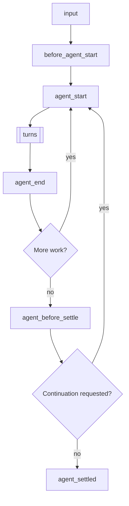
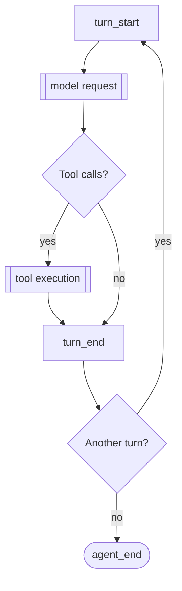
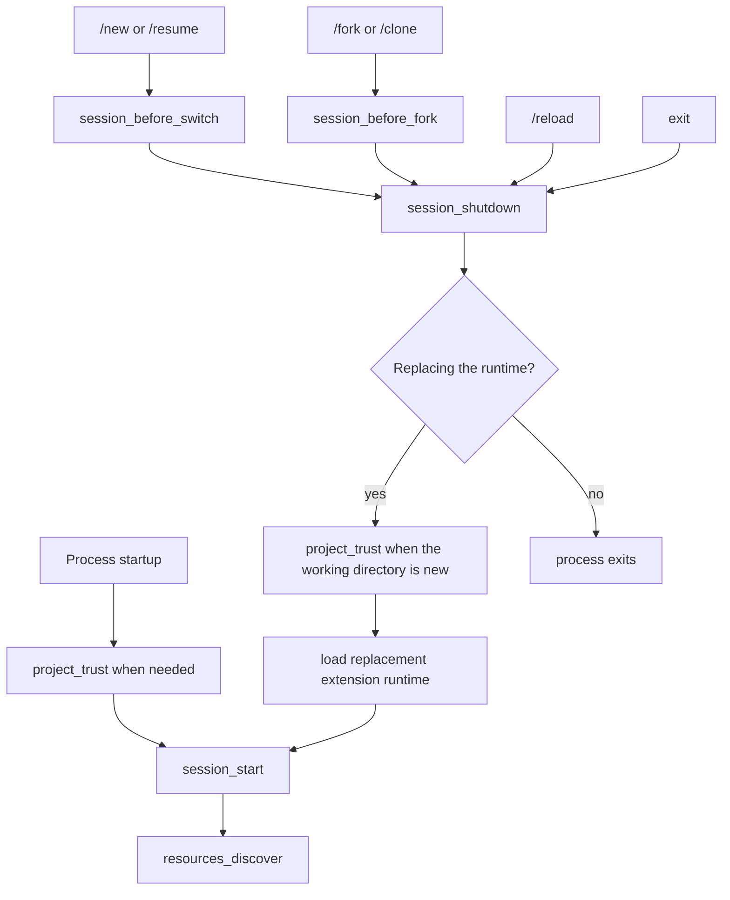

# Extensions（扩展）

> 本页面是 [Pi 官方文档](https://pi.dev/docs/latest/extensions) 的中文翻译。仅供学习参考。

Extensions 是 TypeScript 模块，用于扩展 Pi 的行为。扩展可以订阅生命周期事件、注册 LLM 可调用的自定义工具、添加命令等。

扩展在 Pi 进程内运行，拥有相同的操作系统权限。它可以检查 Prompt、工具调用、文件、凭证和会话历史，因此只加载信任来源的扩展。

> **放置与 /reload：** 将扩展放在 `~/.pi/agent/extensions/`（全局）或 `.pi/extensions/`（项目本地）以实现自动发现。仅用于快速测试时使用 `pi -e ./path.ts`。位于自动发现位置的扩展可以通过 `/reload` 热重载。

**核心能力：**

- **自定义工具**——通过 `pi.registerTool()` 注册 LLM 可调用的工具
- **事件拦截**——阻止或修改工具调用、注入上下文、自定义压缩
- **用户交互**——通过 `ctx.ui` 与用户交互（选择、确认、输入、通知）
- **自定义 UI 组件**——通过 `ctx.ui.custom()` 实现完整的 TUI 组件及键盘输入
- **自定义命令**——通过 `pi.registerCommand()` 注册 `/mycommand` 等命令
- **会话持久化**——通过 `pi.appendEntry()` 存储跨重启的状态
- **自定义渲染**——控制工具调用/结果和消息在 TUI 中的显示方式
- **Provider 和 MCP 服务器**——注册模型 Provider、虚拟模型和 MCP 服务器

**示例用例：**

- 权限门控（确认后执行 `rm -rf`、`sudo` 等危险命令）
- Git 检查点（每次交互前 stash，切换分支时恢复）
- 路径保护（阻止写入 `.env`、`node_modules/` 等）
- 自定义压缩（以自定义方式总结对话）
- 对话摘要（参见 `summarize.ts` 示例）
- 交互式工具（问题、向导、自定义对话框）
- 有状态工具（待办列表、连接池）
- 外部集成（文件监听器、Webhook、CI 触发器）
- 等待期间的游戏（参见 `snake.ts` 示例）

参见 [examples/extensions/](https://github.com/earendil-works/pi/tree/main/packages/coding-agent/examples/extensions/) 获取可运行的实现。

## 目录

- [快速开始](#快速开始)
- [扩展位置](#扩展位置)
- [可用导入](#可用导入)
- [编写扩展](#编写扩展)
  - [异步工厂函数](#异步工厂函数)
  - [扩展风格](#扩展风格)
- [事件](#事件)
  - [生命周期概览](#生命周期概览)
  - [处理器组合](#处理器组合)
  - [启动事件](#启动事件)
  - [资源事件](#资源事件)
  - [会话事件](#会话事件)
  - [Agent 事件](#agent-事件)
  - [模型事件](#模型事件)
  - [工具事件](#工具事件)
  - [用户 Bash 事件](#用户-bash-事件)
  - [输入事件](#输入事件)
- [ExtensionContext](#extensioncontext)
- [ExtensionCommandContext](#extensioncommandcontext)
- [ExtensionAPI 方法](#extensionapi-方法)
- [状态管理](#状态管理)
- [自定义工具](#自定义工具)
  - [工具暴露](#工具暴露)
  - [调用其他工具](#调用其他工具)
  - [动态工具加载](#动态工具加载)
- [MCP 服务器](#mcp-服务器)
- [自定义 UI](#自定义-ui)
- [错误处理](#错误处理)
- [模式行为](#模式行为)
- [示例参考](#示例参考)

<a id="create-an-extension"></a>
<a id="quick-start"></a>

## 快速开始

创建文件 `~/.pi/agent/extensions/my-extension.ts`：

```typescript
import { type ExtensionAPI, isToolCallEventType } from '@earendil-works/pi-coding-agent';
import { Type } from 'typebox';

export default function (pi: ExtensionAPI) {
  // 响应事件
  pi.on('session_start', async (_event, ctx) => {
    ctx.ui.notify('扩展已加载！', 'info');
  });

  pi.on('tool_call', async (event, ctx) => {
    if (isToolCallEventType('bash', event) && event.input.command.includes('rm -rf')) {
      const ok = await ctx.ui.confirm('危险操作！', '允许执行 rm -rf 吗？');
      if (!ok) return { block: true, reason: '用户已阻止' };
    }
  });

  // 注册自定义工具
  pi.registerTool({
    name: 'greet',
    label: '问候',
    description: '按姓名向某人问好',
    parameters: Type.Object({
      name: Type.String({ description: '要问候的名字' }),
    }),
    async execute(toolCallId, params, signal, onUpdate, ctx) {
      return {
        content: [{ type: 'text', text: `你好，${params.name}！` }],
        details: {},
      };
    },
  });

  // 注册命令
  pi.registerCommand('hello', {
    description: '说你好',
    handler: async (args, ctx) => {
      ctx.ui.notify(`你好 ${args || '世界'}！`, 'info');
    },
  });
}
```

使用 `--extension`（或 `-e`）标志测试：

```bash
pi -e ./my-extension.ts
```

<a id="choose-where-it-loads"></a>
<a id="extension-locations"></a>

## 扩展位置

> **安全性：** 扩展以您的完整系统权限运行，可以执行任意代码。请仅从信任的来源安装。

扩展从受信任的位置自动发现。项目本地的 `.pi/extensions` 条目仅在项目被信任后才会加载。

| 位置                                                              | 范围                 |
| ----------------------------------------------------------------- | -------------------- |
| `~/.pi/agent/extensions/*.ts` 或 `*.js`                           | 全局（所有项目）     |
| `~/.pi/agent/extensions/*/index.ts` 或 `index.js`                 | 全局（子目录）       |
| `~/.pi/agent/extensions/*/package.json` 且带 `pi.extensions` 字段 | 全局（带子目录清单） |
| `.pi/extensions/...`                                              | 项目本地，同样的布局 |

通过 `settings.json` 添加额外路径：

```json
{
  "packages": ["npm:@foo/bar@1.0.0", "git:github.com/user/repo@v1"],
  "extensions": ["/path/to/local/extension.ts", "/path/to/local/extension/dir"]
}
```

发现只深入一层。更大的包在 `package.json` 清单中声明入口点。

设置也接受 `builtin:<name>` 形式的内置扩展；见[设置](settings.md#resources)。要通过 npm 或 git 以 Pi 包的形式分享扩展，请参见 [packages.md](packages.md)。

## 可用导入

| 包                                                                    | 用途                                                           |
| --------------------------------------------------------------------- | -------------------------------------------------------------- |
| `@earendil-works/pi-coding-agent`                                     | 扩展类型（`ExtensionAPI`、`ExtensionContext`、事件）和辅助函数 |
| `@earendil-works/pi-agent-core`                                       | Agent 消息和工具类型                                           |
| `typebox`、`typebox/compile`、`typebox/value`                         | 工具参数的模式定义                                             |
| `@earendil-works/pi-ai`                                               | AI 工具（字符串枚举用 `StringEnum`、转录辅助函数、模型类型）   |
| `@earendil-works/pi-ai/compat`、`/models`、`/oauth`、`/providers/all` | Provider 构造、内置 API 和 OAuth 辅助函数                      |
| `@earendil-works/pi-tui`                                              | 自定义渲染的 TUI 组件                                          |

Pi 把这些导入映射到自己的副本，因此扩展共享 Pi 的类和注册表。旧的 `@mariozechner/*` 和 `@sinclair/typebox` 名称映射到相同模块。
npm 依赖同样可用。在扩展旁边（或父目录中）添加 `package.json`，运行 `npm install`，导入语句会自动从 `node_modules/` 解析。

对于通过 `pi install`（npm 或 git）安装的分发式 Pi 包，运行时依赖必须放在 `dependencies` 中；不会安装 `devDependencies`。不要把上面由宿主提供的包列进 `dependencies`。见[声明依赖](packages.md#declare-dependencies)。

Node.js 内置模块（`node:fs`、`node:path` 等）也可用。

## 编写扩展

扩展导出一个默认的工厂函数，该函数接收 `ExtensionAPI`。工厂函数可以是同步的或异步的：

```typescript
import type { ExtensionAPI } from "@earendil-works/pi-coding-agent";

export default function (pi: ExtensionAPI) {
  // 订阅事件
  pi.on("event_name", async (event, ctx) => {
    // ctx.ui 用于用户交互
    const ok = await ctx.ui.confirm("标题", "您确定吗？");
    ctx.ui.notify("完成！", "info");
    ctx.ui.setStatus("my-ext", "处理中...");  // 底部状态
    ctx.ui.setWidget("my-ext", ["第1行", "第2行"]);  // 编辑器上方组件（默认）
  });

  // 注册工具、命令、快捷键、标志
  pi.registerTool({ ... });
  pi.registerCommand("name", { ... });
  pi.registerShortcut("ctrl+x", { ... });
  pi.registerFlag("my-flag", { ... });
}
```

扩展通过 [jiti](https://github.com/unjs/jiti) 加载，因此 TypeScript 无需编译即可工作。

如果工厂函数返回 `Promise`，Pi 会在继续启动前等待它。这意味着异步初始化会在 `session_start`、`resources_discover` 之前以及通过 `pi.registerProvider()` 排队的提供者注册刷新之前完成。

### 异步工厂函数

对一次性启动工作（如获取远程配置或动态发现可用模型）使用异步工厂。

```typescript
import type { ExtensionAPI } from "@earendil-works/pi-coding-agent";

export default async function (pi: ExtensionAPI) {
  const response = await fetch("http://localhost:1234/v1/models");
  const payload = (await response.json()) as {
    data: Array<{
      id: string;
      name?: string;
      context_window?: number;
      max_tokens?: number;
    }>;
  };

  pi.registerProvider("local-openai", {
    baseUrl: "http://localhost:1234/v1",
    apiKey: "$LOCAL_OPENAI_API_KEY"
    api: "openai-completions",
    models: payload.data.map((model) => ({
      id: model.id,
      name: model.name ?? model.id,
      reasoning: false,
      input: ["text"],
      cost: { input: 0, output: 0, cacheRead: 0, cacheWrite: 0 },
      contextWindow: model.context_window ?? 128000,
      maxTokens: model.max_tokens ?? 4096,
    })),
  });
}
```

这种模式使得获取的模型在正常启动期间和 `pi --list-models` 中都可用。模型列表在 Pi 运行期间会变化时，改为实现 `refreshModels`；见 [pi.registerProvider()](#piregisterprovidername-config)。

### 长生命周期资源与关闭

扩展工厂函数可能在从不启动会话的调用中运行。不要从工厂启动后台资源，如进程、socket、文件监视器或定时器。

将后台资源启动推迟到 `session_start` 或需要该资源的命令/工具/事件。注册一个幂等的 `session_shutdown` 处理程序来关闭您启动的任何会话级资源。

### 扩展风格

**单文件**——最简单，适用于小型扩展：

```
~/.pi/agent/extensions/
└── my-extension.ts
```

**带 index.ts 的目录**——适用于多文件扩展：

```
~/.pi/agent/extensions/
└── my-extension/
    ├── index.ts        # 入口点（导出默认函数）
    ├── tools.ts        # 辅助模块
    └── utils.ts        # 辅助模块
```

**带依赖的包**——适用于需要 npm 包的扩展：

```
~/.pi/agent/extensions/
└── my-extension/
    ├── package.json    # 声明依赖和入口点
    ├── package-lock.json
    ├── node_modules/   # 执行 npm install 后
    └── src/
        └── index.ts
```

```json
// package.json
{
  "name": "my-extension",
  "dependencies": {
    "zod": "^3.0.0",
    "chalk": "^5.0.0"
  },
  "pi": {
    "extensions": ["./src/index.ts"]
  }
}
```

在扩展目录中运行 `npm install`，然后从 `node_modules/` 的导入会自动生效。

<a id="extension-events"></a>
<a id="events"></a>

## 事件

<a id="understand-the-lifecycle"></a>

### 生命周期概览

一次 Prompt 会启动一轮运行。输入处理在最前面：

1. 扩展命令（`/name`）运行其处理程序。`input` 事件不会触发。键入的 Prompt 和 RPC Prompt 总会检查命令；`pi.sendUserMessage()` 只在 `expandPromptTemplates: true` 时检查。
2. `input` 处理程序可以拦截、转换或处理文本。
3. Skill 命令（`/skill:name`）和 Prompt 模板（`/template`）展开。
4. `before_agent_start` 运行，然后 Agent 循环开始。

这一轮会重复多个回合，然后检查是否还有更多工作会启动另一次底层 Agent 运行：



更多工作指重试、最后一次尝试的恢复、压缩重试或排队的消息。因此 `agent_end` 不是最终空闲信号；用 `agent_settled` 表示最终空闲。被中止的运行会跳过 `agent_before_settle`，从 `agent_end` 直接到 `agent_settled`。运行开始期间（包括压缩检查和 `before_agent_start`）Pi 算作忙碌，此时发送的消息会进入正在开始的运行。

每个回合发送一次模型请求，并执行 assistant 响应中的工具调用：



模型请求按顺序运行这些钩子：

1. `context`（可修改对话消息）
2. `context_with_system`（可修改完整转录）
3. `before_provider_headers`（可修改请求头）
4. `before_provider_request`（可检查或替换负载）
5. `after_provider_response`（状态和标头，在消费流之前）
6. `provider_stream_event`（原始解析后的流事件），以及 assistant 消息的 `message_start` / `message_update` / `message_end`

会执行的工具调用按顺序运行这些钩子：

1. `tool_execution_start`
2. `tool_call`（可阻止或修改输入）
3. 工具执行期间的 `tool_execution_update`
4. `tool_result`（可修改结果）
5. `tool_execution_end`

不执行的调用会提前结束。未知工具或无效参数会跳过 `tool_call`；被阻止或中止的调用会跳过执行和 `tool_result`。这些情况仍会收到带错误结果的 `tool_execution_end`，因此用 `tool_execution_end` 观察每一次最终确定的调用。

`turn_end` 可以追加条目并请求继续。阈值压缩在自然需要下一回合之前运行。消息事件也会为其他消息触发，例如用户消息、工具结果和自定义消息。Provider 钩子只在传输层暴露对应阶段时运行。

会话启动和替换走另一条生命周期：



`session_start` 携带 `reason: "startup" | "reload" | "new" | "resume" | "fork"`，`session_shutdown` 携带 `reason: "quit" | "reload" | "new" | "resume" | "fork"`。`resources_discover` 在 reload 之后使用 `reason: "reload"`，否则为 `"startup"`。退出包括 Ctrl+C、Ctrl+D、SIGHUP 和 SIGTERM。`project_trust` 在受信任的项目资源加载前运行，会话替换进入新的工作目录时可能再次运行。

其他操作会改变当前会话，但不替换 runtime：

| 操作                                                       | 事件                                                                                             |
| ---------------------------------------------------------- | ------------------------------------------------------------------------------------------------ |
| `/compact` 或自动压缩                                      | `session_before_compact`（可取消或自定义），然后是 `session_compact` 或 `session_compact_failed` |
| `/tree` 导航                                               | `session_before_tree`（可取消或自定义），然后是 `session_tree`                                   |
| `/name` 或 `pi.setSessionName()`                           | `session_info_changed`                                                                           |
| `/model` 或模型循环（`Ctrl+P`）                            | 级别改变或被限制时先 `thinking_level_select`，然后 `model_select`                                |
| thinking 级别更改（设置、快捷键、`pi.setThinkingLevel()`） | `thinking_level_select`                                                                          |
| `!` 或 `!!` 命令                                           | `user_bash`（可拦截）                                                                            |
| 扩展对话框或自定义界面等待用户                             | `ui_prompt_start`、`ui_prompt_end`                                                               |
| 空闲时的 Prompt 缓存刷新                                   | `cache_warming_decision`                                                                         |
| 扩展在启动后注册或移除 MCP 服务器                          | `mcp_servers_change`                                                                             |

<a id="events-and-concurrency"></a>
<a id="work-with-events"></a>

### 处理器组合

处理程序按扩展加载顺序运行，然后按注册顺序。有些事件只通知；有些会转换数据、替换结果或取消操作：

| 模式       | 行为                                                                                                                                         |
| ---------- | -------------------------------------------------------------------------------------------------------------------------------------------- |
| 通知       | 返回值被忽略。只把事件用于观察。                                                                                                             |
| 原地修改   | 后续处理程序能看到对 `before_provider_headers.headers`、`before_agent_start.systemPromptOptions`、`tool_call.input` 等值的修改。             |
| 链式转换   | 后续处理程序收到先前 `input`、`context`、`context_with_system`、`message_end`、`tool_result` 和 `before_provider_request` 处理程序返回的值。 |
| 门控       | 已处理的 input、被阻止的工具调用、被取消的会话操作或已处理的 `user_bash` 命令会停止该操作的正常回退路径。                                    |
| 可操作边界 | 每个 `turn_end` 或 `agent_before_settle` 处理程序都能看到到目前为止提议的条目和继续决定。                                                    |
| 最后覆盖   | 最后一个返回 action 的 `cache_warming_decision` 处理程序胜出。                                                                               |

通知处理程序不应在流式事件上做慢工作。转换处理程序应保留自己不打算拥有的字段。门控处理程序在无法做出安全决定时应失败关闭。

### 启动事件

#### project_trust

在 Pi 决定是否信任包含动态配置（`.pi` 或 `.agents/skills`）的项目之前触发。在启动时和会话替换（例如 `/resume`）进入一个在当前进程中尚未解决信任的 cwd 时运行。仅全局扩展和 CLI `-e` 扩展参与；项目本地扩展在信任解决之前不会加载。

```typescript
pi.on('project_trust', async (event, ctx) => {
  // event.cwd - 当前工作目录
  // ctx 具有有限的信任上下文：cwd、mode、hasUI，以及 select/confirm/input/notify UI 助手
  if (await ctx.ui.confirm('信任项目？', event.cwd)) {
    return { trusted: 'yes', remember: true };
  }
  return { trusted: 'undecided' };
});
```

`project_trust` 处理程序必须返回 `{ trusted: "yes" | "no" | "undecided" }`。返回 `"yes"` 或 `"no"` 的全局扩展或 CLI 扩展拥有该决策；第一个 yes/no 决策获胜并抑制内置的信任提示。使用 `remember: true` 持久化 yes/no 决策；否则仅对当前进程生效。返回 `"undecided"` 让后续处理程序或内置信任流程决定。在提示之前检查 `ctx.hasUI`。如果没有处理程序返回 yes/no，则继续正常的信任解析：先应用 `trust.json` 中保存的决策，然后由 `defaultProjectTrust` 控制 Pi 是询问、信任还是默认拒绝。

<a id="resource-events"></a>

### 资源事件

#### resources_discover

在 `session_start` 后触发，用于让扩展贡献额外的 skill、prompt 和主题路径。
启动路径使用 `reason: "startup"`。重载使用 `reason: "reload"`。

```typescript
pi.on('resources_discover', async (event, _ctx) => {
  // event.cwd - 当前工作目录
  // event.reason - "startup" | "reload"
  return {
    skillPaths: ['/path/to/skills'],
    promptPaths: ['/path/to/prompts'],
    themePaths: ['/path/to/themes'],
  };
});
```

#### mcp_servers_change

扩展绑定之后，扩展注册或注销 MCP 服务器时触发。`event.servers` 列出变更后的全部已注册服务器。处理此事件会把该扩展标记为负责连接已注册服务器的扩展；见 [MCP 服务器](#mcp-servers)。

### 会话事件

关于会话存储内部细节和 SessionManager API，请参见 [Session Format](session-format.md)。

#### session_start

在会话启动、加载或重新加载时触发。

```typescript
pi.on('session_start', async (event, ctx) => {
  // event.reason - "startup" | "reload" | "new" | "resume" | "fork"
  // event.previousSessionFile - 在 "new"、"resume" 和 "fork" 时存在
  ctx.ui.notify(`会话：${ctx.sessionManager.getSessionFile() ?? '临时'}`, 'info');
});
```

#### session_info_changed

当通过 `/name`、RPC 或 `pi.setSessionName()` 设置当前会话显示名称时触发。

```typescript
pi.on('session_info_changed', async (event, ctx) => {
  // event.name - 当前规范化名称，清除后为 undefined
  ctx.ui.notify(`会话重命名：${event.name ?? '(无)'}`, 'info');
});
```

#### session_before_switch

在开始新会话（`/new`）或切换会话（`/resume`）之前触发。

```typescript
pi.on('session_before_switch', async (event, ctx) => {
  // event.reason - "new" 或 "resume"
  // event.targetSessionFile - 要切换到的会话（仅 "resume"）

  if (event.reason === 'new') {
    const ok = await ctx.ui.confirm('清空？', '删除所有消息？');
    if (!ok) return { cancel: true };
  }
});
```

成功切换或新建会话后，Pi 会为旧的扩展实例触发 `session_shutdown`，为新会话重新加载并绑定扩展，然后以 `reason: "new" | "resume"` 和 `previousSessionFile` 触发 `session_start`。
在 `session_shutdown` 中执行清理工作，然后在 `session_start` 中重新建立内存状态。

#### session_before_fork

在通过 `/fork` 分叉或通过 `/clone` 克隆时触发。

```typescript
pi.on('session_before_fork', async (event, ctx) => {
  // event.entryId - 所选条目的 ID
  // event.position - "/fork" 为 "before"，"/clone" 为 "at"
  return { cancel: true }; // 取消分叉/克隆
  // 或者
  return { skipConversationRestore: true }; // 保留用于未来的对话恢复控制
});
```

成功分叉或克隆后，pi 会为旧的扩展实例触发 `session_shutdown`，为新会话重新加载并绑定扩展，然后以 `reason: "fork"` 和 `previousSessionFile` 触发 `session_start`。
在 `session_shutdown` 中执行清理工作，然后在 `session_start` 中重新建立内存状态。

<a id="session_before_compact--session_compact"></a>

#### session_before_compact / session_compact / session_compact_failed

在压缩时触发。详情请参见 [compaction.md](compaction.md)。

```typescript
pi.on('session_before_compact', async (event, ctx) => {
  const { preparation, branchEntries, customInstructions, reason, willRetry, signal } = event;

  // reason - "manual"（/compact）、"threshold" 或 "overflow"
  // willRetry - 压缩后是否重试被中止的轮次（溢出恢复）

  // 取消：
  return { cancel: true };

  // 自定义摘要：
  return {
    compaction: {
      summary: '...',
      firstKeptEntryId: preparation.firstKeptEntryId,
      tokensBefore: preparation.tokensBefore,
      // usage: summaryResponse.usage, // 可选；计入会话总计
    },
  };
});

pi.on('session_compact', async (event, ctx) => {
  // event.compactionEntry - 保存的压缩
  // event.fromExtension - 是否由扩展提供
  // event.reason - "manual"（/compact）、"threshold" 或 "overflow"
  // event.willRetry - 压缩后是否重试被中止的轮次（溢出恢复）
});

pi.on('session_compact_failed', async (event, ctx) => {
  // event.reason - "manual"（/compact）、"threshold" 或 "overflow"
  // event.errorMessage - 非中止失败时存在
  // event.aborted - 取消/中止的压缩为 true
  // event.willRetry - 压缩后是否重试被中止的轮次（溢出恢复）
  // event.fromExtension - 是否正在使用扩展提供的压缩内容
});
```

#### session_before_tree / session_tree

在 `/tree` 导航时触发。关于树导航的概念，请参见 [Sessions](sessions.md)。

```typescript
pi.on('session_before_tree', async (event, ctx) => {
  const { preparation, signal } = event;
  // preparation.targetId, oldLeafId, commonAncestorId, entriesToSummarize,
  // userWantsSummary, customInstructions, replaceInstructions, label
  return { cancel: true };
  // 或提供自定义摘要（仅当 preparation.userWantsSummary 为 true 时使用）：
  return {
    summary: {
      summary: '...',
      // usage: summaryResponse.usage, // 可选；计入会话总计
      details: {},
    },
  };
  // 或覆盖摘要选项：customInstructions、replaceInstructions、label
});

pi.on('session_tree', async (event, ctx) => {
  // event.newLeafId, oldLeafId, summaryEntry, fromExtension
});
```

#### session_shutdown

在已启动的会话运行时被销毁前触发。用于清理从 `session_start` 或其他会话级钩子中打开的资源。

```typescript
pi.on('session_shutdown', async (event, ctx) => {
  // event.reason - "quit" | "reload" | "new" | "resume" | "fork"
  // event.targetSessionFile - 会话替换流程的目标会话
  // 清理、保存状态等
});
```

### Agent 事件

<a id="before_agent_start"></a>

#### before_agent_start

在运行开始前、输入处理和展开之后触发。可以注入消息和/或修改系统提示。

`event.messageType` 说明是什么启动了这次运行：`"user"` 表示 Prompt 或 `pi.sendUserMessage()`，带有 `prompt` 和 `images`；`"custom"` 表示空闲时的 `pi.sendMessage(..., { triggerTurn: true })`，带有起始 `message`，没有 `prompt`。

```typescript
pi.on('before_agent_start', async (event, ctx) => {
  // event.messageType - "user" | "custom"
  // event.prompt, event.images - 用户的提示文本和图片（messageType 为 "user"）
  // event.message - 启动本次运行的自定义消息（messageType 为 "custom"）
  // event.systemPrompt - 当前为此处理程序链式拼接的系统提示
  //   （包括之前 before_agent_start 处理程序的更改）
  // event.systemPromptOptions - 用于构建系统提示的结构化选项
  //   .customPrompt - 来自 --system-prompt、SYSTEM.md 或自定义模板的精确提示前缀
  //   .forceSystemPrompt - 可选，精确替换完整提示
  //   .selectedTools - 当前在提示中激活的工具
  //   .toolSnippets - 每个工具的一行描述
  //   .hiddenTools - 请求中省略声明的已选工具
  //   .toolGuidelines - 按工具名索引的规则要点
  //   .promptGuidelines - 额外的自定义规则要点
  //   .sections - 按标签名索引的自定义 XML 包裹区块
  //   .appendSystemPrompt - 来自 --append-system-prompt 标志的文本
  //   .cwd - 工作目录
  //   .contextFiles - AGENTS.md 文件和其他加载的上下文文件
  //   .skills - 已加载的 skill

  return {
    // 注入持久消息（存储在会话中，发送给 LLM）
    message: {
      customType: 'my-extension',
      content: '给 LLM 的额外上下文',
      display: true,
    },
    // 为此轮替换系统提示（在扩展间链式拼接）
    systemPrompt: event.systemPrompt + '\n\n此轮的额外指令...',
  };
});
```

`systemPromptOptions` 字段为扩展提供了与 Pi 构建系统提示相同的结构化数据。这些集合是可变的。优先修改 `sections`、`selectedTools` 或 `promptGuidelines`：Pi 会把生成的提示区块与模型已有的内容做 diff，然后追加一条系统消息，只修补发生变化的区块。返回 `systemPrompt`，或设置 `forceSystemPrompt`，会为本轮运行替换整个提示：每个 Provider 都会收到该强制文本作为其前置系统提示（变更时会造成一次缓存未命中），会话记录则继续记录结构化区块。工具选择的变更会同时改系统提示里的工具说明，以及实际可调用的 Provider 工具；在处理程序内调用 `pi.setActiveTools()` 与修改 `selectedTools` 效果相同。接受会话中途系统消息的模型会在对话中间直接收到补丁，并保留已缓存的前缀；其他模型会得到重放后的提示作为系统提示，每次变更会有一次缓存未命中。

在 `before_agent_start` 内部，`event.systemPrompt` 和 `ctx.getSystemPrompt()` 都反映当前处理程序的链式系统提示。后面的 `before_agent_start` 处理程序仍可再次修改它。

返回的 `message` 会加入任意一种运行；检查 `messageType` 以跳过由自定义消息启动的运行。

<a id="agent_start--agent_end--agent_settled"></a>

#### agent_start / agent_end / agent_before_settle / agent_settled

`agent_start` 在底层 agent 运行开始时触发。`agent_end` 在该运行结束时触发，但 Pi 可能仍会自动重试、自动压缩后重试或继续排队的 follow-up 消息。`agent_before_settle` 是最后一个可操作的边界：它可以追加会话条目并请求一次继续。`agent_settled` 是最终且仅通知的边界；对于需要知道 Pi 不会再自动继续运行的状态集成，使用它。

```typescript
pi.on('agent_start', async (_event, ctx) => {});

pi.on('agent_end', async (event, ctx) => {
  // event.messages - 此次底层运行产生的消息
});

let addedReviewReminder = false;
pi.on('agent_before_settle', async (event, ctx) => {
  if (addedReviewReminder) return;
  addedReviewReminder = true;
  return {
    entries: [
      ...event.entries,
      {
        type: 'custom_message',
        customType: 'review-reminder',
        content: 'Review the final diff before replying.',
        display: false,
      },
    ],
    continue: true,
  };
});

pi.on('agent_settled', async (event, ctx) => {
  // event.aborted - 运行因被中止而结束时为 true，例如按了 Escape
  // ctx.isIdle() 为 true；在此请求的运行会在所有 settled 处理程序完成后启动。
});
```

如果在 `agent_before_settle` 处理程序运行期间运行被中止，仍然有效的返回值会被提交，但请求的继续会被抑制。从 `agent_settled` 请求的工作会推迟到所有 settled 处理程序完成之后，因此通知分发不可重入。

#### ui_prompt_start / ui_prompt_end

仅通知的生命周期事件，用于阻塞用户界面的扩展 UI Prompt。它们在 `ctx.ui.select()`、`ctx.ui.confirm()`、`ctx.ui.input()`、`ctx.ui.editor()` 和 `ctx.ui.custom()` 周围触发，因此宿主/状态集成可以报告「等待用户」而不是仅报告「运行中」。

嵌套或重叠的 Prompt 会合并为一个外部等待跨度。处理器尽力调用，不会在显示或关闭 Prompt 之前等待。

```typescript
pi.on('ui_prompt_start', async (event, ctx) => {
  // event.reason === "ui_prompt"
  // event.kind: "select" | "confirm" | "input" | "editor" | "custom"
  // event.title: prompt title when available
});

pi.on('ui_prompt_end', async (event, ctx) => {
  // Pi is no longer waiting on that UI prompt span.
});
```

#### turn_start / turn_end

每个回合（一次 LLM 响应 + 工具调用）触发一次。

```typescript
pi.on('turn_start', async (event, ctx) => {
  // event.turnIndex, event.timestamp
});

let replacedResponse = false;
pi.on('turn_end', async (event, ctx) => {
  // event.turnIndex, event.message, event.toolResults
  // event.entries 包含到目前为止提议的结构条目。
  if (replacedResponse || event.outcome !== 'completed' || event.toolResults.length > 0) return;
  replacedResponse = true;
  return {
    entries: [
      ...event.entries,
      { type: 'context_edit', targetId: event.messageEntryId, replacement: null },
      {
        type: 'custom_message',
        customType: 'replacement-instruction',
        content: 'Answer again using the persisted user request.',
        display: false,
      },
    ],
    continue: true,
  };
});
```

`turn_end` 在 assistant 和工具结果消息持久化之后、底层 `turn_end` 事件之前运行。重试退避和最后一次尝试的恢复仍然发生在 `agent_end` 之后，保持其既有的生命周期与队列顺序；`agent_before_settle` 在该工作完成后看到修复过的投影。边界处理程序按扩展加载和注册顺序运行。每个处理程序都会在 `event.entries` 中看到此前的提议，并看到由这些提议重建的 `event.context`。返回 `entries` 或 `continue` 只替换该字段；省略的字段保留当前提议。允许的草稿条目类型为 `custom`、`custom_message`、`context_edit` 和 `compaction`。完整的提议会在所有处理程序结束后按列表顺序追加之前被校验；处理程序出错会报告，后续处理程序仍会运行。校验可以防止部分应用的语义错误，但持久化不是事务性的。

`continue: true` 确保该次边界调用会发出一次后续 Provider 请求。如果工具结果、steering 或 follow-up 已经触发该请求，则由它们满足该决策，不再额外发起请求；否则 Pi 会发出一次仅上下文的请求。error 和 aborted 响应仍是硬退出。`continue: false` 永远不会抑制自然产生的工作。请为继续条件加保护：无条件的 `continue: true` 会在下一次响应后再次被求值，可能形成死循环。`custom_message` 草稿会贡献一条 user 角色的模型消息，但它由扩展撰写：不会运行人类输入钩子、斜杠命令、Skill 或 Prompt 模板。

构造 `TurnEndEvent` 值的宿主集成现在必须提供 `messageEntryId`、`toolResultEntryIds`、`outcome`、`entries`、`continue` 和 `context`。对 `ExtensionEvent` 做穷尽 switch 也必须处理 `agent_before_settle`。`ExtensionRunner.emit()` 不再包含可操作的回合边界；请通过 `emitBoundary(baseEvent, buildContext)` 分发 `turn_end` 和 `agent_before_settle`，以便处理程序收到链式预览。其他专用 runner 方法仍会为 `session_before_*` 等事件返回结果。

#### message_start / message_update / message_end

消息生命周期更新时触发。

- `message_start` 和 `message_end` 对每条消息触发，包括用户、助手、工具结果和自定义消息。
- `message_update` 对助手流式更新触发。
- `message_end` 处理程序可以返回 `{ message }` 以替换最终确定的消息。替换必须保持相同的 `role`。

```typescript
pi.on('message_start', async (event, ctx) => {
  // event.message
});

pi.on('message_update', async (event, ctx) => {
  // event.message
  // event.assistantMessageEvent（逐 token 流事件）
});

pi.on('message_end', async (event, ctx) => {
  if (event.message.role !== 'assistant') return;

  return {
    message: {
      ...event.message,
      usage: {
        ...event.message.usage,
        cost: {
          ...event.message.usage.cost,
          total: 0.123,
        },
      },
    },
  };
});
```

#### tool_execution_start / tool_execution_update / tool_execution_end

工具执行生命周期更新时触发。

在并行工具模式下：

- `tool_execution_start` 在预检阶段按助手源顺序发出
- `tool_execution_update` 事件可能在不同工具间交错
- `tool_execution_end` 在每个工具完成后按工具完成顺序发出
- 最终的 `toolResult` 消息事件仍在稍后按助手源顺序发出

```typescript
pi.on('tool_execution_start', async (event, ctx) => {
  // event.toolCallId, event.toolName, event.args
});

pi.on('tool_execution_update', async (event, ctx) => {
  // event.toolCallId, event.toolName, event.args, event.partialResult
});

pi.on('tool_execution_end', async (event, ctx) => {
  // event.toolCallId, event.toolName, event.result, event.isError
  // event.durationMs - execute() 花费的毫秒数；工具未运行时没有该字段
});
```

这三个事件、`tool_call` 和 `tool_result` 在另一个工具发起调用时携带 `parentToolCallId`；见[调用其他工具](#调用其他工具)。

#### context

在每次 LLM 调用前触发。以非破坏性方式修改消息。关于消息类型，请参见 [Session Format](session-format.md)。

```typescript
pi.on('context', async (event, ctx) => {
  // event.messages - 深拷贝，不含系统消息，可安全修改
  const filtered = event.messages.filter((m) => !shouldPrune(m));
  return { messages: filtered };
});
```

`event.messages` 保存的是不含系统消息的对话。提示与工具声明属于 Pi，不在此钩子的范围内：当处理程序返回改动过的列表时，Pi 会把当前的提示区块和工具声明重放为一条置于返回消息之前的开头系统消息。因此从压缩摘要过滤、开窗或截取都不会丢掉提示或工具。列表未改动时，会话中途的系统消息会留在原位，接受它们的模型因此保留缓存前缀。处理程序添加的系统消息会保留在 Pi 的头部之后。要持久地修改提示或工具集，请使用 [`before_agent_start`](#before_agent_start) 或 `pi.setActiveTools()`；要针对单次请求编辑系统消息，请使用 [`context_with_system`](#context_with_system)。

#### context_with_system

在每次 LLM 调用前触发，此时所有 `context` 处理程序都已运行，且 Pi 已恢复提示与工具状态。`event.messages` 是完整转录，包括开头的系统消息以及任何会话中途的提示或工具补丁（见 [Session Format](session-format.md#sessionmessageentry)）。返回的消息会原样发送：该钩子对该请求的提示和工具声明拥有控制权。

```typescript
import { getCurrentSystemMessage } from '@earendil-works/pi-ai';

pi.on('context_with_system', async (event, ctx) => {
  const cut = findCutIndex(event.messages);
  // 折叠被丢弃的前缀，让其中的提示和工具状态作为新的头部保留下来。
  const head = getCurrentSystemMessage(event.messages.slice(0, cut));
  return { messages: head ? [head, ...event.messages.slice(cut)] : event.messages.slice(cut) };
});
```

规则：保持索引 0 处有一条系统消息（Provider 从那里读取提示和初始工具声明；如果处理程序把它丢掉，Pi 会报错）。删除一条系统消息会同时删除它携带的工具声明和区块补丁。用 `@earendil-works/pi-ai` 的 `getCurrentSystemPrompt()` 和 `getCurrentTools()` 检查输出。处理程序按扩展加载顺序运行；从 `before_agent_start` 强制设置的 `systemPrompt` 之后仍会投射到请求上。

#### before_provider_headers

在出站 HTTP 请求头组装完成后触发。用于添加、覆盖或移除请求头。

处理程序直接修改 `event.headers`。将某个键设置为字符串即可添加或覆盖，设置为 `null` 即可删除。

```typescript
pi.on('before_provider_headers', (event, ctx) => {
  // 添加或覆盖 —— 例如用于网关追踪/归因的会话 ID
  event.headers['x-session-id'] = ctx.sessionManager.getSessionId();

  // 删除 Pi 本次调用添加的追踪头
  event.headers['X-OpenRouter-Title'] = null;
});
```

每个 Provider 请求只会触发一次；重试会复用相同的请求头，不会重新触发该钩子。

#### before_provider_request

在构建 Provider 特定负载后、请求发送前触发。处理程序按扩展加载顺序运行。返回 `undefined` 保持负载不变。返回其他任何值将替换后续处理程序和实际请求的负载。

这个钩子可以重写 Provider 级别的系统指令或完全删除它们。这些负载级别的更改不会反映在 `ctx.getSystemPrompt()` 中，后者报告的是 Pi 的系统提示字符串，而不是最终序列化的 Provider 负载。

```typescript
pi.on('before_provider_request', (event, ctx) => {
  console.log(JSON.stringify(event.payload, null, 2));

  // 可选：替换负载
  // return { ...event.payload, temperature: 0 };
});
```

这主要用于调试 Provider 序列化和缓存行为。

#### after_provider_response

在收到 HTTP 响应后、消费其流内容前触发。处理程序按扩展加载顺序运行。

```typescript
pi.on('after_provider_response', (event, ctx) => {
  // event.status - HTTP 状态码
  // event.headers - 规范化的响应标头
  if (event.status === 429) {
    console.log('频率受限', event.headers['retry-after']);
  }
});
```

标头的可用性取决于 Provider 和传输层。抽象 HTTP 响应的 Provider 可能不会暴露标头。

#### provider_stream_event

在 Pi 规范化之前，每个已解析的 Provider 流事件都会触发。仅通知，不持久化。

```typescript
pi.on('provider_stream_event', (event, ctx) => {
  // event.provider, event.api, event.model
  // event.data - Pi 能拿到的最早结构化值（只读）
});
```

`event.data` 不一定是原始 HTTP 字节或 SSE 帧。请把它当作只读，因为修改会影响规范化。处理程序按流顺序等待，因此慢处理程序会延迟流的消费。处理程序错误会被报告，但不改变 Provider 响应。可选的查看器见 [`debug-provider.ts`](https://github.com/earendil-works/pi/blob/main/packages/coding-agent/examples/extensions/debug-provider.ts)，它按 assistant 消息分组显示原始事件。

#### cache_warming_decision

在每次 Prompt 缓存刷新前触发，此时已填入 Pi 的决定。事件只携带 Pi 的成本估算；其他信息请用 `ctx.model`、`ctx.isIdle()` 和 `ctx.getContextUsage()`。

```typescript
pi.on('cache_warming_decision', (event, ctx) => {
  // event.warmCost: 本次刷新的价格
  // event.missCost: 如果该缓存条目丢失，下一次请求的额外价格
  // event.continuationProbability: Pi 对请求能否及时到达的估计
  // event.action: "warm" | "stop"，Pi 的决定

  if (ctx.model?.provider === 'my-provider') {
    return { action: 'stop' };
  }
});
```

返回 `{ action: "warm" }` 或 `{ action: "stop" }` 可以覆盖 Pi 的决定；最后一个返回 action 的处理器生效。`"stop"` 会结束预热，直到下一次真实请求。

### 模型事件

#### model_select

在通过 `/model` 命令、模型循环（`Ctrl+P`）或 `pi.setModel()` 更改模型时触发。恢复会话不会触发它；在 `session_start` 中读取 `ctx.model` 来初始化依赖模型的状态。

```typescript
pi.on('model_select', async (event, ctx) => {
  // event.model - 新选择的模型
  // event.previousModel - 之前的模型（首次选择时为 undefined）
  // event.source - "set" | "cycle"

  const prev = event.previousModel ? `${event.previousModel.provider}/${event.previousModel.id}` : '无';
  const next = `${event.model.provider}/${event.model.id}`;

  ctx.ui.notify(`模型已更改（${event.source}）：${prev} -> ${next}`, 'info');
});
```

在活动模型更改时，用于更新 UI 元素（状态栏、底部栏）或执行模型特定的初始化。

#### thinking_level_select

在思考级别更改时触发。此事件仅用于通知；处理程序的返回值被忽略。

```typescript
pi.on('thinking_level_select', async (event, ctx) => {
  // event.level - 新选择的思考级别
  // event.previousLevel - 之前的思考级别

  ctx.ui.setStatus('thinking', `思考级别：${event.level}`);
});
```

在 `pi.setThinkingLevel()`、模型更改或内置思考级别控件更改活动思考级别时，用于更新扩展 UI。

<a id="tool-call-events"></a>
<a id="tool-events"></a>

### 工具事件

#### tool_call

在 `tool_execution_start` 之后、工具执行之前触发。**可以阻止。** 使用 `isToolCallEventType` 来缩小范围并获得类型化输入。

在 `tool_call` 运行之前，pi 会等待先前发出的 Agent 事件通过 `AgentSession` 完成排空。这意味着 `ctx.sessionManager` 已更新至当前助手工具调用消息。

在默认的并行工具执行模式下，来自同一条助手消息的兄弟工具调用会按顺序预检，然后并发执行。`tool_call` 不保证能在 `ctx.sessionManager` 中看到来自同一条助手消息的兄弟工具结果。

`event.input` 是可变的。原地修改它以在工具执行前修补工具参数。

行为保证：

- 对 `event.input` 的修改会影响实际的工具执行
- 后面的 `tool_call` 处理程序可以看到之前处理程序所做的修改
- 修改后不会重新进行验证
- `tool_call` 的返回值通过 `{ block: true, reason?: string, terminate?: boolean }` 控制阻止
- `terminate` 仅适用于被阻止的调用；只有当批次中所有最终化的结果都是终止性时，agent 才会提前停止

```typescript
import { isToolCallEventType } from '@earendil-works/pi-coding-agent';

pi.on('tool_call', async (event, ctx) => {
  // event.toolName - "bash"、"read"、"write"、"edit" 等
  // event.toolCallId
  // event.input - 工具参数（可变）

  // 内置工具：不需要类型参数
  if (isToolCallEventType('bash', event)) {
    // event.input 是 { command: string; timeout?: number }
    event.input.command = `source ~/.profile\n${event.input.command}`;

    if (event.input.command.includes('rm -rf')) {
      return { block: true, reason: '危险命令', terminate: true };
    }
  }

  if (isToolCallEventType('read', event)) {
    // event.input 是 { path: string; offset?: number; limit?: number }
    console.log(`读取：${event.input.path}`);
  }
});
```

#### 类型化自定义工具输入

自定义工具应导出其输入类型：

```typescript
// my-tool.ts
import { type Static, Type } from 'typebox';

export const myToolSchema = Type.Object({ action: Type.String() });
export type MyToolInput = Static<typeof myToolSchema>;
```

使用带有显式类型参数的 `isToolCallEventType`：

```typescript
import { isToolCallEventType } from '@earendil-works/pi-coding-agent';
import type { MyToolInput } from './my-tool.ts';

pi.on('tool_call', (event) => {
  if (isToolCallEventType<'my_tool', MyToolInput>('my_tool', event)) {
    event.input.action; // 有类型
  }
});
```

#### tool_result

在工具执行完成后、`tool_execution_end` 和最终 toolResult 消息事件发出之前触发。**可以修改结果。**

在并行工具模式下，`tool_result` 和 `tool_execution_end` 可能按工具完成顺序交错，而最终的 `toolResult` 消息事件稍后按助手源顺序发出。

`tool_result` 处理程序像中间件一样链式拼接：

- 处理程序按扩展加载顺序运行
- 每个处理程序看到之前处理程序更改后的最新结果
- 处理程序可以返回部分补丁（`content`、`details`、`structuredContent`、`isError` 或 `usage`）；省略的字段保持当前值
- 替换 `content` 时如果不返回 `structuredContent`，结构化内容会被丢掉，因为它可能已经不匹配

使用 `ctx.signal` 在处理程序内部执行嵌套的异步工作。这让 Esc 可以取消扩展启动的模型调用、`fetch()` 和其他支持中止感知的操作。

```typescript
import { isBashToolResult } from "@earendil-works/pi-coding-agent";

pi.on("tool_result", async (event, ctx) => {
  // event.toolName, event.toolCallId, event.input, event.parentToolCallId
  // event.content, event.details, event.structuredContent, event.isError, event.usage

  if (isBashToolResult(event)) {
    // event.details 是 BashToolDetails 类型
  }

  const response = await fetch("https://example.com/summarize", {
    method: "POST",
    body: JSON.stringify({ content: event.content }),
    signal: ctx.signal,
  });

  // 修改结果：
  return { content: [...], details: {...}, isError: false, usage: nestedModelUsage };
});
```

<a id="user-bash-events"></a>

### 用户 Bash 事件

#### user_bash

在用户执行 `!` 或 `!!` 命令时触发。**可以拦截。**

```typescript
import { createLocalBashOperations } from '@earendil-works/pi-coding-agent';

pi.on('user_bash', (event, ctx) => {
  // event.command - bash 命令
  // event.excludeFromContext - 如果使用 !! 前缀则为 true
  // event.cwd - 工作目录

  // 选项 1：提供自定义操作（例如 SSH）
  return { operations: remoteBashOps };

  // 选项 2：包装 Pi 的内置本地 bash 后端
  const local = createLocalBashOperations();
  return {
    operations: {
      exec(command, cwd, options) {
        return local.exec(`source ~/.profile\n${command}`, cwd, options);
      },
    },
  };

  // 选项 3：完全替换——直接返回结果
  return { result: { output: '...', exitCode: 0, cancelled: false, truncated: false } };
});
```

返回 `undefined` 会继续传递给下一个处理程序，如果都没有处理则本地执行。返回有效结果会停止传播：`operations` 通过所提供的后端执行命令，而 `result` 直接记录已完成的命令，不再执行它。

<a id="input-events"></a>

### 输入事件

#### input

在收到用户输入后、扩展命令检查之后、skill 和模板扩展之前触发。事件看到的是原始输入文本，因此 `/skill:foo` 和 `/template` 尚未被扩展。

**处理顺序：**

1. 先检查扩展命令（`/cmd`）——如果找到，处理程序运行，跳过 input 事件。来自 `pi.sendUserMessage()` 的消息只在 `expandPromptTemplates: true` 时检查。
2. `input` 事件触发——可以拦截、转换或处理
3. 如果未处理：skill 命令（`/skill:name`）扩展为 skill 内容
4. 如果未处理：提示模板（`/template`）扩展为模板内容
5. Agent 处理开始（`before_agent_start` 等）

```typescript
pi.on('input', async (event, ctx) => {
  // event.text - 原始输入（在 skill/模板扩展之前）
  // event.images - 附带的图片（如果有）
  // event.source - "interactive"（键入）、"rpc"（API）或 "extension"（通过 sendUserMessage）
  // event.streamingBehavior - "steer" | "followUp" | undefined
  //   空闲时为 undefined，"steer" 表示流中中断，
  //   "followUp" 表示 agent 完成前排队的消息

  // 转换：在扩展前重写输入
  if (event.text.startsWith('?quick ')) return { action: 'transform', text: `简要回复：${event.text.slice(7)}` };

  // 处理：不经过 LLM 直接回复（扩展显示自己的反馈）
  if (event.text === 'ping') {
    ctx.ui.notify('pong', 'info');
    return { action: 'handled' };
  }

  // 按来源路由：跳过扩展注入消息的处理
  if (event.source === 'extension') return { action: 'continue' };

  // 在扩展前拦截 skill 命令
  if (event.text.startsWith('/skill:')) {
    // 可以转换、阻止或让其通过
  }

  return { action: 'continue' }; // 默认：通过到扩展
});
```

**结果：**

- `continue`——保持不变通过（如果处理程序不返回任何内容，则为默认）
- `transform`——修改文本/图片，然后继续到扩展
- `handled`——完全跳过 Agent（第一个返回此值的处理程序生效）

转换在处理程序间链式拼接。参见 [input-transform.ts](https://github.com/earendil-works/pi/tree/main/packages/coding-agent/examples/extensions/input-transform.ts) 和 [input-transform-streaming.ts](https://github.com/earendil-works/pi/tree/main/packages/coding-agent/examples/extensions/input-transform-streaming.ts)（streamingBehavior 感知路由）。

<a id="use-extension-context"></a>
<a id="extensioncontext"></a>

## ExtensionContext

所有处理程序都接收 `ctx: ExtensionContext`。工具的 `execute()` 接收 `ExtensionToolContext`，它增加了 `ctx.tools` 和 `ctx.executeTool()`（见[调用其他工具](#调用其他工具)）。命令处理程序接收 [`ExtensionCommandContext`](#extensioncommandcontext)。

### ctx.ui

用于用户交互的 UI 方法。完整详情请参见 [自定义 UI](#自定义-ui)。

### ctx.mode

当前运行模式：`"tui"`、`"rpc"`、`"json"` 或 `"print"`。使用 `ctx.mode === "tui"` 来保护仅终端功能，如 `custom()`、组件工厂、终端输入和直接 TUI 渲染。

### ctx.hasUI

在 TUI 和 RPC 模式下为 `true`。在打印模式（`-p`）和 JSON 模式下为 `false`。使用此属性来保护对话框方法（`select`、`confirm`、`input`、`editor`）和即发即弃方法（`notify`、`setStatus`、`setWidget`、`setTitle`、`setEditorText`），这些方法在 TUI 和 RPC 模式下均可工作。在 RPC 模式下，某些 TUI 特定方法是无操作或返回默认值（参见 [RPC 扩展 UI](rpc-extension-ui.md)）。

### ctx.cwd

当前工作目录。

构造项目本地配置路径时，请使用 `CONFIG_DIR_NAME` 而非硬编码 `.pi`。重新分发的发行版可以使用不同的配置目录名。

```typescript
import { CONFIG_DIR_NAME, type ExtensionAPI } from '@earendil-works/pi-coding-agent';
import { join } from 'node:path';

export default function (pi: ExtensionAPI) {
  pi.on('session_start', (_event, ctx) => {
    const projectConfigPath = join(ctx.cwd, CONFIG_DIR_NAME, 'my-extension.json');
    // ...
  });
}
```

### ctx.isProjectTrusted()

返回项目本地信任在当前会话上下文中是否生效。这包括临时信任决策和 CLI 信任覆盖，而不仅仅是全局信任存储中保存的决策。

在读取只应对受信任项目生效的项目本地扩展配置之前使用此方法。

### ctx.sessionManager

对会话状态的只读访问：`getCwd()`、`getSessionDir()`、`getSessionId()`、`getSessionFile()`、`getSessionName()`、`getHeader()`、`getEntries()`、`getEntry()`、`getBranch()`、`getTree()`、`getLeafId()`、`getLeafEntry()`、`getLabel()`、`buildContextEntries()` 和 `buildSessionProjection()`。条目类型见 [Session Format](session-format.md)。

对于 `tool_call`，此状态在处理程序运行前已通过当前助手消息同步。在并行工具执行模式下，仍不能保证包含同一条助手消息中的兄弟工具结果。

```typescript
ctx.sessionManager.getEntries(); // 所有条目
ctx.sessionManager.getBranch(); // 当前分支
ctx.sessionManager.buildContextEntries(); // 应用了压缩的活跃分支条目
ctx.sessionManager.getLeafId(); // 当前叶子条目 ID
```

### ctx.modelRegistry / ctx.model / ctx.thinkingLevel / ctx.scopedModels

访问模型、Provider 和已解析的认证信息。`ctx.modelRegistry.getProvider(id)` 返回有效的 pi-ai Provider，`getProviderAuth(id)` 解析其当前的 API Key、请求头、base URL 和 Provider 作用域环境变量，无需加载模型。`ctx.model` 是当前活动模型，`ctx.thinkingLevel` 是其当前有效的 thinking 级别。

`ctx.scopedModels` 是限定到当前会话的只读模型列表——与 `/scoped-models` 命令显示的内容相同。它在会话启动时通过 `--models` CLI 标志和 `enabledModels` 设置解析（与可用目录进行 minimatch 匹配，匹配 `provider/modelId` 或纯 `modelId`）。未配置作用域时为空，表示所有可用模型均可使用。每个条目为 `{ model, thinkingLevel? }`，其中 `thinkingLevel` 仅在某个模式明确指定时才设置（例如 `anthropic/*:high`）。使用它可以构建与内置选择器一致的模型选择器，无需通过 `ctx.modelRegistry.getAvailable()` 枚举整个目录。

#### 流式模型调用

使用 `ctx.modelRegistry.streamSimple(model, context, options)` 传入 `reasoning` 等与 Provider 无关的选项，或使用 `complete(model, context, options)` 以 API 特定选项等待最终 assistant 消息。两者都使用已配置的 Provider 并解析认证，包括通过 `pi.registerProvider()` 注册的 Provider。请用它们替代 `pi-ai/compat` 的流式函数，后者无法看到扩展注册的 Provider。

`streamSimple()` 返回 `AssistantMessageEventStream`。迭代它以获取响应事件，并 await `.result()` 获得最终消息。设置失败会产生错误事件和错误结果。

对于非聊天模型，`findOfType()`、`getModelsOfType()`、`getAvailableOfType()` 和 `getModelOfType()` 查找图片和分类器模型，`classify()` 和 `generateImages()` 调用它们。见[使用分类器模型](models.md#use-classifier-models)和[使用图片模型](models.md#use-image-models)。

### ctx.signal

当前的 Agent 中止信号，如果未激活 Agent 回合则为 `undefined`。

将此用于扩展处理程序启动的、支持中止感知的嵌套工作，例如：

- `fetch(..., { signal: ctx.signal })`
- 接受 `signal` 的模型调用
- 接受 `AbortSignal` 的文件或进程辅助函数

`ctx.signal` 通常在活动回合事件（如 `tool_call`、`tool_result`、`message_update` 和 `turn_end`）期间定义。
在空闲或非回合上下文（如会话事件、扩展命令以及在 Pi 空闲时触发的快捷键）中通常为 `undefined`。

```typescript
pi.on('tool_result', async (event, ctx) => {
  const response = await fetch('https://example.com/api', {
    method: 'POST',
    body: JSON.stringify(event),
    signal: ctx.signal,
  });

  const data = await response.json();
  return { details: data };
});
```

### ctx.isIdle() / ctx.abort() / ctx.hasPendingMessages()

控制流辅助方法。当 Pi 正在处理 agent 运行、自动重试、自动压缩重试或排队的继续消息时，`ctx.isIdle()` 为 false。

### ctx.shutdown()

请求优雅关闭 Pi。

- **交互模式：** 延迟到 Agent 变为空闲后（处理完所有排队的引导和后续消息后）。
- **RPC 模式：** 延迟到下一个空闲状态（完成当前命令响应后，等待下一个命令时）。
- **打印模式：** 无操作。进程在处理完所有提示后自动退出。

在退出前向所有扩展发出 `session_shutdown` 事件。在所有上下文中可用（事件处理程序、工具、命令、快捷键）。

```typescript
pi.on('tool_call', (event, ctx) => {
  if (isFatal(event.input)) {
    ctx.shutdown();
  }
});
```

### ctx.getContextUsage()

返回当前活动模型的上下文使用情况。在可用时使用最后一次的助手使用数据，然后估算尾部消息的 token 数。

```typescript
const usage = ctx.getContextUsage();
if (usage?.tokens != null && usage.tokens > 100_000) {
  // ...
}
```

### ctx.compact()

触发压缩但不等待完成。使用 `onComplete` 和 `onError` 进行后续操作。

```typescript
ctx.compact({
  customInstructions: '关注最近的更改',
  onComplete: (result) => {
    ctx.ui.notify('压缩完成', 'info');
  },
  onError: (error) => {
    ctx.ui.notify(`压缩失败：${error.message}`, 'error');
  },
});
```

### ctx.getSystemPrompt()

返回 Pi 当前的系统提示字符串。

- 在 `before_agent_start` 期间，反映当前回合到目前为至链式拼接的系统提示更改。
- 不包括后续 `context` 消息的修改。
- 不包括 `before_provider_request` 负载重写。
- 如果在您的扩展之后加载了其他扩展，它们仍可以更改最终发送的内容。

```typescript
pi.on('before_agent_start', (event, ctx) => {
  const prompt = ctx.getSystemPrompt();
  console.log(`系统提示长度：${prompt.length}`);
});
```

## ExtensionCommandContext

命令处理程序接收 `ExtensionCommandContext`，它扩展了 `ExtensionContext` 并添加了会话控制方法。这些方法仅在命令中可用，因为在事件处理程序中调用它们可能导致死锁。

### ctx.getSystemPromptOptions()

返回 Pi 当前用于构建系统提示的基础输入。

```typescript
const options = ctx.getSystemPromptOptions();
const contextPaths = options.contextFiles?.map((file) => file.path) ?? [];
```

其形状和可变性与 `before_agent_start` 的 `event.systemPromptOptions` 相同：自定义或强制的提示、活跃工具、每个工具的一行描述、按工具的准则要点和自定义准则、自定义区块、追加的系统提示文本、cwd、已加载的上下文文件和已加载的 Skill。它可能包含完整的上下文文件内容，因此请将其视为敏感的扩展本地数据，避免通过命令列表、日志或自动补全元数据暴露它。

此方法报告当前的基础提示输入。它不包括每轮 `before_agent_start` 链式系统提示更改、后续的 `context` 事件消息修改或 `before_provider_request` 负载重写。

### ctx.waitForIdle()

等待 Agent 完全 settled，包括自动重试、自动压缩重试和排队的继续消息：

```typescript
pi.registerCommand('my-cmd', {
  handler: async (args, ctx) => {
    await ctx.waitForIdle();
    // Agent 现在空闲，可以安全修改会话
  },
});
```

### ctx.newSession(options?)

创建新会话：

```typescript
const parentSession = ctx.sessionManager.getSessionFile();
const kickoff = '在替换会话中继续';

const result = await ctx.newSession({
  parentSession,
  setup: async (sm) => {
    sm.appendMessage({
      role: 'user',
      content: [{ type: 'text', text: '来自前一个会话的上下文...' }],
      timestamp: Date.now(),
    });
  },
  withSession: async (ctx) => {
    // 在此处只使用替换会话的 ctx。
    await ctx.sendUserMessage(kickoff);
  },
});

if (result.cancelled) {
  // 扩展取消了新会话
}
```

选项：

- `parentSession`：要在新会话标头中记录的父会话文件
- `setup`：在 `withSession` 运行前修改新会话的 `SessionManager`
- `withSession`：针对新的替换会话上下文运行切换后工作。不要使用捕获的旧 `pi` / 命令 `ctx`；参见 [会话替换生命周期及陷阱](#会话替换生命周期及陷阱)。

### ctx.fork(entryId, options?)

从特定条目分叉，创建新的会话文件：

```typescript
const result = await ctx.fork('entry-id-123', {
  withSession: async (ctx) => {
    // 在此处只使用替换会话的 ctx。
    ctx.ui.notify('现在在分叉会话中', 'info');
  },
});
if (result.cancelled) {
  // 扩展取消了分叉
}

const cloneResult = await ctx.fork('entry-id-456', { position: 'at' });
if (cloneResult.cancelled) {
  // 扩展取消了克隆
}
```

选项：

- `position`：`"before"`（默认）在选定的用户消息之前分叉，将该提示恢复到编辑器中
- `position`：`"at"` 复制经过所选条目的活动路径，但不恢复编辑器文本
- `withSession`：针对新的替换会话上下文运行切换后工作。不要使用捕获的旧 `pi` / 命令 `ctx`；参见 [会话替换生命周期及陷阱](#会话替换生命周期及陷阱)。

### ctx.navigateTree(targetId, options?)

导航到会话树中的不同点。在 agent 响应、手动或自动压缩、或其他树导航进行中时会拒绝，即使传入 `summarize: false`。这些冲突下活动分支保持不变，promise 被拒绝而不是返回 `{ cancelled: true }`。请等待当前操作结束（例如在命令处理程序中使用 `await ctx.waitForIdle()`）后重试。`summarize` 已设置但没有可用模型，或目标条目不存在时，也会拒绝：

```typescript
const result = await ctx.navigateTree('entry-id-456', {
  summarize: true,
  customInstructions: '关注错误处理更改',
  replaceInstructions: false, // true = 完全替换默认提示
  label: 'review-checkpoint',
});
```

选项：

- `summarize`：是否为被遗弃的分支生成摘要
- `customInstructions`：摘要器的自定义指令
- `replaceInstructions`：如果为 true，`customInstructions` 替换默认提示而不是附加
- `label`：要附加到分支摘要条目（如果未摘要则为目标条目）的标签

### ctx.switchSession(sessionPath, options?)

切换到不同的会话文件：

```typescript
const result = await ctx.switchSession('/path/to/session.jsonl', {
  withSession: async (ctx) => {
    await ctx.sendUserMessage('在替换会话中恢复工作');
  },
});
if (result.cancelled) {
  // 扩展通过 session_before_switch 取消了切换
}
```

选项：

- `withSession`：针对新的替换会话上下文运行切换后工作。不要使用捕获的旧 `pi` / 命令 `ctx`；参见 [会话替换生命周期及陷阱](#会话替换生命周期及陷阱)。

要发现可用会话，使用静态方法 `SessionManager.list()` 或 `SessionManager.listAll()`：

```typescript
import { SessionManager } from '@earendil-works/pi-coding-agent';

pi.registerCommand('switch', {
  description: '切换到其他会话',
  handler: async (args, ctx) => {
    const sessions = await SessionManager.list(ctx.cwd);
    if (sessions.length === 0) return;
    const choice = await ctx.ui.select(
      '选择会话：',
      sessions.map((s) => s.path),
    );
    if (choice) {
      await ctx.switchSession(choice, {
        withSession: async (ctx) => {
          ctx.ui.notify('会话已切换', 'info');
        },
      });
    }
  },
});
```

### 会话替换生命周期及陷阱

`withSession` 接收一个全新的 `ReplacedSessionContext`，它扩展了 `ExtensionCommandContext` 并增加了绑定到替换会话的异步 `sendMessage()` 和 `sendUserMessage()` 辅助方法。

生命周期和陷阱：

- `withSession` 仅在旧会话发出 `session_shutdown`、旧运行时被拆除、替换会话已重新绑定且新的扩展实例已收到 `session_start` 后运行。
- 回调仍在原始闭包中执行，而不是在新扩展实例内部。这意味着您的旧扩展实例可能在 `withSession` 开始前已经运行了关闭清理。
- 捕获的旧 `pi` / 旧命令 `ctx` 的会话绑定对象在替换后已过时，使用时会抛出错误。仅使用传递给 `withSession` 的 `ctx` 进行会话绑定工作。
- 先前提取的原始对象仍然是您的责任。例如，如果您在替换前捕获 `const sm = ctx.sessionManager`，`sm` 仍然是旧的 `SessionManager` 对象。替换后不要重复使用它。
- `withSession` 中的代码应假设您 `session_shutdown` 处理程序已使其失效的任何状态都已不存在。只捕获能干净应对关闭的普通数据，如字符串、ID 和序列化配置。

安全模式：

```typescript
pi.registerCommand('handoff', {
  handler: async (_args, ctx) => {
    const kickoff = '从替换会话继续';
    await ctx.newSession({
      withSession: async (ctx) => {
        await ctx.sendUserMessage(kickoff);
      },
    });
  },
});
```

不安全模式：

```typescript
pi.registerCommand('handoff', {
  handler: async (_args, ctx) => {
    const oldSessionManager = ctx.sessionManager;
    await ctx.newSession({
      withSession: async (_ctx) => {
        // 旧的已过时对象：不要这样做
        oldSessionManager.getSessionFile();
        pi.sendUserMessage('wrong');
      },
    });
  },
});
```

### ctx.reload()

执行与 `/reload` 相同的重载流程。

```typescript
pi.registerCommand('reload-runtime', {
  description: '重载扩展、Skill、Prompt、主题和上下文文件',
  handler: async (_args, ctx) => {
    await ctx.reload();
    return;
  },
});
```

重要行为：

- `await ctx.reload()` 为当前扩展运行时发出 `session_shutdown`
- 然后重新加载资源并发出带有 `reason: "reload"` 的 `session_start` 和带有 `"reload"` 原因的 `resources_discover`
- 当前运行的命令处理程序仍在旧调用帧中继续
- `await ctx.reload()` 之后的代码仍从重载前的版本运行
- `await ctx.reload()` 之后的代码不得假设旧的扩展内存状态仍然有效
- 处理程序返回后，未来的命令/事件/工具调用将使用新的扩展版本

为获得可预测的行为，将重载视为该处理程序的终结点（`await ctx.reload(); return;`）。

工具使用 `ExtensionToolContext` 而不是 `ExtensionCommandContext`，因此不能调用 `ctx.reload()`，而且 Agent 运行期间 Pi 也不能重载。要让 LLM 触发重载，让工具记下请求，再从 `agent_settled` 运行命令。处理程序在这里发送的消息会在所有 settled 处理程序结束后被处理：

```typescript
let reloadRequested = false;

pi.registerTool({
  name: 'reload_runtime',
  label: '重载运行时',
  description: '重载扩展、Skill、Prompt、主题和上下文文件',
  parameters: Type.Object({}),
  async execute() {
    reloadRequested = true;
    return {
      content: [{ type: 'text', text: '已请求重载。Pi 会在这次响应之后重载。' }],
      details: {},
      terminate: true,
    };
  },
});

pi.on('agent_settled', () => {
  if (!reloadRequested) return;
  reloadRequested = false;
  pi.sendUserMessage('/reload-runtime', { expandPromptTemplates: true });
});
```

`expandPromptTemplates: true` 会把文本当作命令分派。不加它，或用 `deliverAs` 排队时，文本会作为普通用户消息到达模型。见 [reload-runtime.ts](https://github.com/earendil-works/pi/blob/main/packages/coding-agent/examples/extensions/reload-runtime.ts)。

## ExtensionAPI 方法

### pi.on(event, handler)

订阅事件。返回取消订阅函数，只移除本次注册。事件类型和返回值请参见 [事件](#事件)。

```typescript
const unsubscribe = pi.on('agent_end', async (event) => {
  unsubscribe();
  await updateIntegration(event.messages);
});
```

处理程序按扩展加载顺序运行，同一扩展内按注册顺序运行。在一次分发进行中添加或移除处理程序，不影响本次分发。

### pi.registerTool(definition)

注册 LLM 可调用的自定义工具。完整详情请参见 [自定义工具](#自定义工具)。

`pi.registerTool()` 在扩展加载期间和启动后都可以工作。您可以在 `session_start`、命令处理程序或其他事件处理程序中调用它。新工具在同一会话中立即刷新，因此它们会出现在 `pi.getAllTools()` 中，无需 `/reload`。注册工具会激活它，除非它设置了 `defaultActive: false`，或 [exposure](#tool-exposure) 不是 `direct` 或 `model-only`。

使用 `pi.setActiveTools()` 在运行时启用或禁用工具（包括动态添加的工具）。

使用 `promptSnippet` 将自定义工具加入默认系统 Prompt 的 `<tools>` 部分，作为一行条目；使用 `promptGuidelines` 在工具激活时向其 `<rules>` 部分追加特定于工具的要点。

**重要提示：** `promptGuidelines` 的要点以扁平方式追加到 `<rules>` 部分，没有工具名称前缀。每个准则必须明确指出其引用的工具——避免写"使用此工具当..."，因为 LLM 无法判断"此"指代哪个工具。请写"当...时使用 my_tool"。

完整示例请参见 [dynamic-tools.ts](https://github.com/earendil-works/pi/tree/main/packages/coding-agent/examples/extensions/dynamic-tools.ts)。

```typescript
import { Type } from "typebox";
import { StringEnum } from "@earendil-works/pi-ai";

pi.registerTool({
  name: "my_tool",
  label: "我的工具",
  description: "此工具的功能",
  promptSnippet: "根据操作汇总或转换文本",
  promptGuidelines: ["当用户要求汇总之前生成的文本时使用 my_tool。"],
  parameters: Type.Object({
    action: StringEnum(["list", "add"] as const),
    text: Type.Optional(Type.String()),
  }),
  prepareArguments(args) {
    // 可选兼容性 shim。在模式验证前运行。
    // 返回当前模式形状，例如将遗留字段合并到现代参数对象中。
    return args;
  },

  async execute(toolCallId, params, signal, onUpdate, ctx) {
    // 流式进度；部分结果也需要 details
    onUpdate?.({ content: [{ type: "text", text: "工作中..." }], details: { result: "pending" } });

    return {
      content: [{ type: "text", text: "完成" }],
      details: { result: "..." },
      // usage: nestedModelResponse.usage,          // 可选嵌套 LLM 用量
    };
  },

  // 可选：自定义渲染
  renderCall(args, theme, context) { ... },
  renderResult(result, options, theme, context) { ... },
});
```

### pi.sendMessage(message, options?)

向会话注入自定义消息。自定义消息参与 LLM 上下文。对于不应发送给 LLM 的持久 TUI 专用内容，请使用带 [`pi.registerEntryRenderer()`](#piregisterentryrenderercustomtype-renderer) 的 [`pi.appendEntry()`](#piappendentrycustomtype-data)。

```typescript
pi.sendMessage({
  customType: "my-extension",
  content: "消息文本",
  display: true,
  details: { ... },
}, {
  triggerTurn: true,
  deliverAs: "steer",
});
```

**选项：**

- `deliverAs` - 传递模式：
  - `"steer"`（默认）- 在流式传输时排队。在当前助手回合完成工具调用后、下一次 LLM 调用之前传递。
  - `"followUp"` - 等待 Agent 完成。仅当 Agent 不再有工具调用时传递。
  - `"nextTurn"` - 排队用于下一次用户提示。不中断或触发任何操作。
- `triggerTurn: true` - 如果 Agent 空闲，立即触发 LLM 响应。仅适用于 `"steer"` 和 `"followUp"` 模式（`"nextTurn"` 忽略此选项）。不设置时，空闲会话只存储消息，不开始回合。
- `triggerTurn: false` 且正在流式传输 - 消息不会被 steer，也不会作为 follow-up 排队；当前回合结束后才追加。

### pi.sendUserMessage(content, options?)

向 Agent 发送用户消息。不同于 `sendMessage()` 发送自定义消息，此方法发送一条实际用户消息，看起来像是用户键入的。它会开始或排队一个回合，除非 `input` 处理程序处理了它，或者在 `expandPromptTemplates: true` 时它运行了扩展命令。

```typescript
// 纯文本消息
pi.sendUserMessage('2+2 等于多少？');

// 带内容数组（文本 + 图片）
pi.sendUserMessage([
  { type: 'text', text: '描述这张图片：' },
  { type: 'image', data: '...', mimeType: 'image/png' },
]);

// 流式传输期间 - 必须指定传递模式
pi.sendUserMessage('关注错误处理', { deliverAs: 'steer' });
pi.sendUserMessage('然后进行汇总', { deliverAs: 'followUp' });

// Opt in to extension command dispatch and skill/prompt template expansion
pi.sendUserMessage('/review src/index.ts', { expandPromptTemplates: true });
```

**选项：**

- `deliverAs` - Agent 正在流式传输时需要：
  - `"steer"` - 将消息排队，在当前助手回合完成工具调用后传递
  - `"followUp"` - 等待 Agent 完成所有工具
- `expandPromptTemplates` - 分派扩展命令，并展开 Skill 命令和 Prompt 模板。默认为 `false`。

不在流式传输时，消息会立即发送并触发新回合。在流式传输时如果未提供 `deliverAs`，消息会被拒绝，Pi 报告扩展错误。

完整示例请参见 [send-user-message.ts](https://github.com/earendil-works/pi/tree/main/packages/coding-agent/examples/extensions/send-user-message.ts)。

### pi.appendEntry(customType, data?)

持久化扩展数据。自定义条目不参与 LLM 上下文。在交互模式下，当与 `pi.registerEntryRenderer()` 配合使用时，它们也可以在聊天记录中渲染。

```typescript
pi.appendEntry('my-state', { count: 42 });
pi.appendEntry('status-card', { title: '已索引文件', count: 17 });

// 在重载时恢复
pi.on('session_start', async (_event, ctx) => {
  for (const entry of ctx.sessionManager.getEntries()) {
    if (entry.type === 'custom' && entry.customType === 'my-state') {
      // 从 entry.data 重建
    }
  }
});
```

### pi.setSessionName(name)

设置会话显示名称（在会话选择器中显示，而不是第一条消息）。

```typescript
pi.setSessionName('重构认证模块');
```

### pi.getSessionName()

获取当前会话名称（如果已设置）。

```typescript
const name = pi.getSessionName();
if (name) {
  console.log(`会话：${name}`);
}
```

### pi.setLabel(entryId, label)

设置或清除条目上的标签。标签是用户定义的标记，用于书签和导航（在 `/tree` 选择器中显示）。

```typescript
// 设置标签
pi.setLabel(entryId, 'checkpoint-before-refactor');

// 清除标签
pi.setLabel(entryId, undefined);

// 通过 sessionManager 读取标签
const label = ctx.sessionManager.getLabel(entryId);
```

标签在会话中持久保存，并在重启后保留。用于标记对话树中的重要点（回合、检查点）。

### pi.registerCommand(name, options)

注册命令。

如果多个扩展注册了相同的命令名称，pi 会全部保留，并按加载顺序分配数字调用后缀，例如 `/review:1` 和 `/review:2`。

```typescript
pi.registerCommand('stats', {
  description: '显示会话统计',
  handler: async (args, ctx) => {
    const count = ctx.sessionManager.getEntries().length;
    ctx.ui.notify(`${count} 个条目`, 'info');
  },
});
```

可选：为 `/command ...` 添加参数自动补全：

```typescript
import type { AutocompleteItem } from '@earendil-works/pi-tui';

pi.registerCommand('deploy', {
  description: '部署到环境',
  getArgumentCompletions: (prefix: string): AutocompleteItem[] | null => {
    const envs = ['dev', 'staging', 'prod'];
    const items = envs.map((e) => ({ value: e, label: e }));
    const filtered = items.filter((i) => i.value.startsWith(prefix));
    return filtered.length > 0 ? filtered : null;
  },
  handler: async (args, ctx) => {
    ctx.ui.notify(`部署到：${args}`, 'info');
  },
});
```

### pi.getCommands()

获取当前会话中可通过 `prompt` 调用的斜杠命令。包括扩展命令、prompt 模板和 skill 命令。
列表顺序与 RPC `get_commands` 一致：扩展优先，然后是模板，最后是 skill。

```typescript
const commands = pi.getCommands();
const bySource = commands.filter((command) => command.source === 'extension');
const userScoped = commands.filter((command) => command.sourceInfo.scope === 'user');
```

每个条目的结构：

```typescript
{
  name: string; // 可调用的命令名称，不含前导斜杠。可能带有后缀如 "review:1"
  description?: string;
  source: "extension" | "prompt" | "skill";
  sourceInfo: {
    path: string;
    source: string;
    scope: "user" | "project" | "temporary";
    origin: "package" | "top-level";
    baseDir?: string;
  };
}
```

使用 `sourceInfo` 作为规范来源字段。不要从命令名称或临时路径解析推断所有权。

内置交互命令（如 `/model` 和 `/settings`）不包括在此列表中。它们仅在交互模式下处理，通过 `prompt` 发送不会执行。

### pi.registerMessageRenderer(customType, renderer)

为具有您的 `customType` 的自定义消息注册自定义 TUI 渲染器。自定义消息通过 `pi.sendMessage()` 创建并参与 LLM 上下文。参见 [自定义 UI](#自定义-ui)。

### pi.registerMarkdownTransformer(transformer)

为普通用户文本、助手文本和 thinking 块中的 Markdown 注册转换器。转换器按扩展加载顺序执行，每个转换器接收上一个转换器返回的 Markdown。链执行完毕后，Pi 使用内置渲染器渲染转换后的内容。

转换器接收 Markdown 字符串和一个上下文对象：

- `messageType` — `"user"`、`"assistant"` 或 `"assistant-thinking"`
- `isStreaming` — 对部分助手更新为 `true`；对用户、已完成的助手和恢复的消息为 `false`
- `availableWidth` — 转换后 Markdown 内容可用的精确终端列数

返回转换后的 Markdown：

```typescript
pi.registerMarkdownTransformer((markdown, { messageType, isStreaming }) => {
  if (isStreaming || messageType === 'assistant-thinking') return markdown;
  return markdown.replaceAll('-->', '→');
});
```

如果转换器抛出异常，Pi 保留目前生成的 Markdown 并继续执行下一个转换器。此 hook 仅用于显示：原始消息在会话和模型上下文中保持不变。它在新用户消息、助手流式更新、恢复的会话消息和终端宽度变化时运行，因此转换器应保持同步且开销低廉。

### pi.registerEntryRenderer(customType, renderer)

为具有您的 `customType` 的自定义条目注册自定义 TUI 渲染器。自定义条目通过 `pi.appendEntry()` 创建，不参与 LLM 上下文。

```typescript
import { Box, Text } from '@earendil-works/pi-tui';

pi.registerEntryRenderer('status-card', (entry, { expanded }, theme) => {
  const data = entry.data as { title: string; count: number };
  const box = new Box(1, 1, (text) => theme.bg('customMessageBg', text));
  box.addChild(new Text(`${theme.bold(data.title)}: ${data.count}`));
  if (expanded) {
    box.addChild(new Text(theme.fg('dim', JSON.stringify(data, null, 2))));
  }
  return box;
});

pi.appendEntry('status-card', { title: '已索引文件', count: 17 });
```

### pi.registerShortcut(shortcut, options)

注册键盘快捷键。快捷键格式和内置快捷键请参见 [keybindings.md](keybindings.md)。

```typescript
pi.registerShortcut('ctrl+shift+p', {
  description: '切换计划模式',
  handler: async (ctx) => {
    ctx.ui.notify('已切换！');
  },
});
```

### pi.registerFlag(name, options)

注册 CLI 标志。

```typescript
pi.registerFlag('plan', {
  description: '以计划模式启动',
  type: 'boolean',
  default: false,
});

// 检查值
if (pi.getFlag('plan')) {
  // 计划模式已启用
}
```

### pi.exec(command, args, options?)

不经过 Shell 执行命令。

```typescript
const result = await pi.exec('git', ['status'], { signal, timeout: 5000 });
// result.stdout, result.stderr, result.code, result.killed, result.truncated
```

选项：`signal` 和 `timeout` 会终止命令，`cwd` 设置工作目录，`maxBuffer` 限制 stdout 与 stderr 的合计大小（默认 256 MiB）。输出超过 `maxBuffer` 时，Pi 会终止命令，并返回上限以内的输出，同时带上 `truncated: true`、`killed: true` 和非零 `code`。只要是 Pi 终止了命令，`killed` 就为 true：超时、中止，或触及 `maxBuffer`。忽略 SIGTERM 的命令会在 5 秒后收到 SIGKILL。

### pi.getActiveTools() / pi.getAllTools() / pi.setActiveTools(names)

管理活动工具。适用于内置工具和动态注册的工具。`pi.getActiveTools()` 返回活跃工具名称，类型为 `string[]`；`pi.getAllTools()` 返回所有已配置工具的元数据。

```typescript
const active = pi.getActiveTools(); // ["read", "bash", ...]
const all = pi.getAllTools();
// all = [{
//   name: "read",
//   description: "读取文件内容...",
//   parameters: ...,
//   promptGuidelines: ["Use read to examine files instead of cat or sed."],
//   exposure: "direct",
//   sourceInfo: { path: "builtin:read", source: "builtin", scope: "temporary", origin: "top-level" }
// }, ...]
// Pi 自带的工具：核心工具，以及 builtin:mcp 等内置扩展的工具
const shippedTools = all.filter((t) => t.sourceInfo.source === 'builtin');
// 已安装或本地扩展的工具
const extensionTools = all.filter((t) => t.sourceInfo.source !== 'builtin' && t.sourceInfo.source !== 'sdk');
pi.setActiveTools([...new Set([...active, 'my_custom_tool'])]); // 保留当前工具并启用 my_custom_tool
pi.setActiveTools(['read', 'bash']); // 只保留 read 和 bash
```

`pi.getAllTools()` 返回 `name`、`description`、`parameters`、`promptGuidelines`、`exposure`、`sourceInfo`，以及设置了的 `namespace`、`annotations` 和 `reachesTools`。

典型的 `sourceInfo` 值：

- `source: "builtin"` 表示 Pi 自带的工具：核心工具（`path: "builtin:<tool>"`）以及 `builtin:mcp` 等内置扩展注册的工具（`path: "builtin:<extension>"`）
- `source: "sdk"` 表示通过 `createAgentSession({ customTools })` 传入的工具
- 扩展源元数据用于扩展注册的工具

`pi.setActiveTools()` 会忽略未知工具和 `hidden` 工具。`codemode` 或 `deferred` exposure 的工具无论是否激活，都可以从 codemode 脚本调用。

### pi.setModel(model)

设置当前会话的模型。此变更会记录在会话历史中，并在恢复该会话时还原，但不会改变新会话使用的已配置 `defaultProvider` 或 `defaultModel`。如果模型的 Provider 未配置认证，返回 `false`。自定义模型配置请参见 [models.md](models.md)。

```typescript
const model = ctx.modelRegistry.find('anthropic', 'claude-sonnet-4-5');
if (model) {
  const success = await pi.setModel(model);
  if (!success) {
    ctx.ui.notify('此模型没有 API 密钥', 'error');
  }
}
```

### pi.getThinkingLevel() / pi.setThinkingLevel(level)

获取当前思考级别。级别会被限制到模型能力范围内（非推理模型始终使用 "off"）。更改会触发 `thinking_level_select`。

`pi.setThinkingLevel()` 会更改当前会话的思考级别。此变更会记录在会话历史中，并在恢复该会话时还原，但不会改变新会话使用的已配置默认值。

```typescript
const current = pi.getThinkingLevel(); // "off" | "minimal" | "low" | "medium" | "high" | "xhigh" | "max"
pi.setThinkingLevel('high');
```

### pi.events

扩展间通信的共享事件总线：

```typescript
pi.events.on("my:event", (data) => { ... });
pi.events.emit("my:event", { ... });
```

### pi.registerProvider(name, config)

动态注册或覆盖模型 Provider。适用于代理、自定义端点或团队范围的模型配置。

在扩展工厂函数中进行的调用会排队，并在运行器初始化时应用。之后进行的调用——例如来自用户设置流程后的命令处理程序——立即生效，无需 `/reload`。

动态 Provider 可以实现 `refreshModels`。Pi 在模型刷新期间调用它，通过 Provider 同步发布返回的列表，并传入规范的凭证/已存储目录/网络/信号上下文。扩展通过经过世代检查的 `context.publish({ persist: entry })` 决定是否持久化目录元数据；如 llama.cpp 等实时服务器可以直接返回模型而不持久化它们。

`context.signal` 始终是具体的信号，Provider 回调必须将其传给阻塞 I/O。公开的 `ModelRuntime.refresh()` 和 `ModelRegistry.refresh()` 调用接受可选信号，省略时不受时限约束；扩展和应用自行决定自己的截止时间。取消会停止调用方的等待（即使 Provider 忽略信号），但停止底层工作仍需要配合。

需要原生 Provider 认证、过滤、刷新或流行为的扩展可以从 `@earendil-works/pi-ai` 注册一个完整的 `Provider`。该 Provider 成为组合基础，`models.json` 覆盖仍然在其之上应用。

```typescript
import { createProvider, openAICompletionsApi } from "@earendil-works/pi-ai/compat";

const provider = createProvider({
  id: "local-server",
  name: "Local Server",
  baseUrl: "http://localhost:8080/v1",
  auth: {
    apiKey: {
      name: "Local server setup",
      async login(interaction) {
        return {
          type: "api_key",
          key: await interaction.prompt({ type: "secret", message: "API key" }),
        };
      },
      async resolve({ credential }) {
        return credential?.key
          ? { auth: { apiKey: credential.key }, source: "stored API key" }
          : undefined;
      },
    },
  },
  models: [],
  api: openAICompletionsApi(),
});

pi.registerProvider(provider);

// 使用自定义模型注册新 Provider
pi.registerProvider("my-proxy", {
  name: "我的代理",
  baseUrl: "https://proxy.example.com",
  apiKey: "$PROXY_API_KEY",  // 环境变量引用
  api: "anthropic-messages",
  models: [
    {
      id: "claude-sonnet-4-20250514",
      name: "Claude 4 Sonnet（代理）",
      reasoning: false,
      input: ["text", "image"],
      cost: { input: 0, output: 0, cacheRead: 0, cacheWrite: 0 },
      contextWindow: 200000,
      maxTokens: 16384
    }
  ]
});

// 覆盖现有 Provider 的 baseUrl（保留所有模型）
pi.registerProvider("anthropic", {
  baseUrl: "https://proxy.example.com"
});

// 注册不持久化已发现模型的实时 llama.cpp 目录
pi.registerProvider("llama.cpp", {
  baseUrl: "http://localhost:8080/v1",
  apiKey: "local",
  api: "openai-completions",
  async refreshModels({ signal }) {
    const response = await fetch("http://localhost:8080/v1/models", { signal });
    const { data } = (await response.json()) as { data: Array<{ id: string }> };
    return data.map(({ id }) => ({
      id,
      name: id,
      reasoning: false,
      input: ["text"],
      cost: { input: 0, output: 0, cacheRead: 0, cacheWrite: 0 },
      contextWindow: 128000,
      maxTokens: 16384
    }));
  }
});

// 注册支持 OAuth 的 Provider 以支持 /login
pi.registerProvider("corporate-ai", {
  baseUrl: "https://ai.corp.com",
  api: "openai-responses",
  models: [...],
  oauth: {
    name: "企业 AI（SSO）",
    async login(callbacks) {
      // 自定义 OAuth 流程
      callbacks.onAuth({ url: "https://sso.corp.com/..." });
      const code = await callbacks.onPrompt({ message: "输入代码：" });
      return { refresh: code, access: code, expires: Date.now() + 3600000 };
    },
    async refreshToken(credentials, signal) {
      signal.throwIfAborted();
      // 刷新逻辑
      return credentials;
    },
    getApiKey(credentials) {
      return credentials.access;
    }
  }
});
```

对象形式接受完整的 pi-ai `Provider`，包括原生 `auth`、`getModels`、`refreshModels`、`filterModels`、`stream` 和 `streamSimple` 行为。

**旧版配置选项：**

- `name` - Provider 在 UI 中（如 `/login`）的显示名称。
- `baseUrl` - API 端点 URL。每个已定义的模型都需要一个，来自模型定义或 Provider。
- `apiKey` - API 密钥字面值、环境变量插值（`$ENV_VAR` 或 `${ENV_VAR}`）或前导 `!command`。可选：不设置时，用户用 `/login` 存储密钥。`$$` 转义 `$`，`$!` 转义字面 `!` 而不触发命令执行。
- `api` - API 类型：`"anthropic-messages"`、`"openai-completions"`、`"openai-responses"` 等。
- `headers` - 要包含在请求中的自定义标头。
- `authHeader` - 如果为 true，自动添加 `Authorization: Bearer` 标头。
- `models` - 模型定义数组。如果提供，替换此 Provider 的所有现有模型。模型定义可以设置 `baseUrl` 以覆盖该模型的 Provider 端点。
- `refreshModels` - 异步动态发现回调。其返回的模型替换扩展提供的模型。`context.stored` 包含已持久化的 Provider 快照；仅在需要更新目录数据时使用经过世代检查的 `context.publish({ persist: entry })`。使用 `persist: null` 删除该快照。
- `oauth` - 支持 `/login` 的 OAuth Provider 配置。提供后，该 Provider 会出现在登录菜单中。
- `streamSimple` - 用于非标准 API 的自定义流式实现。

高级主题（自定义流式 API、OAuth 详情、模型定义参考）请参见 [custom-provider.md](custom-provider.md)。

### pi.unregisterProvider(name)

移除先前注册的 Provider 及其模型。被该 Provider 覆盖的内置模型会被恢复。如果该 Provider 未注册，则无效果。

与 `registerProvider` 类似，在初始加载阶段之后调用时立即生效，无需 `/reload`。

```typescript
pi.registerCommand('my-setup-teardown', {
  description: '移除自定义代理 Provider',
  handler: async (_args, _ctx) => {
    pi.unregisterProvider('my-proxy');
  },
});
```

### pi.registerVirtualModel(model) / pi.unregisterVirtualModel(provider, id)

注册一个可选的目录条目，把每次请求路由到物理模型。`ctx.model` 和会话的模型选择使用虚拟模型的名字；assistant 消息记录路由器选中的物理模型和 thinking 级别。再次注册相同的 Provider 和 ID 会替换该虚拟模型。见[虚拟模型](virtual-models.md)。

### pi.registerMcpServer(name, config) / pi.unregisterMcpServer(name) / pi.getMcpServers()

为当前会话注册 MCP 服务器。见 [MCP 服务器](#mcp-servers)。

### pi.registerToolRenderer(resolver)

选择任意工具调用的绘制方式，包括尚未注册的工具，例如恢复会话后、服务器连上之前的 MCP 工具。resolver 收到工具名和 `next()`。`next()` 返回剩余 resolver（按扩展加载顺序）以及已注册工具会使用的渲染，因此 `next() ?? mine` 只补空缺。

```typescript
pi.registerToolRenderer((toolName, next) => {
  if (!toolName.startsWith('mcp__')) return next();
  return next() ?? { renderCall: (args, theme) => new Text(theme.fg('toolTitle', toolName), 0, 0) };
});
```

### pi.getSettings()

返回有效设置的副本，全局设置和项目设置已合并，覆盖已应用。

<a id="persist-state"></a>

## 状态管理

有状态的扩展应将状态存储在工具结果的 `details` 中，以支持正确的分支：

```typescript
export default function (pi: ExtensionAPI) {
  let items: string[] = [];

  // 从活动分支重建状态
  const reconstruct = (ctx: ExtensionContext) => {
    items = [];
    for (const entry of ctx.sessionManager.getBranch()) {
      if (entry.type === 'message' && entry.message.role === 'toolResult') {
        if (entry.message.toolName === 'my_tool') {
          items = (entry.message.details as { items?: string[] } | undefined)?.items ?? [];
        }
      }
    }
  };

  pi.on('session_start', async (_event, ctx) => reconstruct(ctx));
  pi.on('session_tree', async (_event, ctx) => reconstruct(ctx)); // /tree 会改变分支

  pi.registerTool({
    name: 'my_tool',
    // ...
    async execute(toolCallId, params, signal, onUpdate, ctx) {
      items.push('new item');
      return {
        content: [{ type: 'text', text: '已添加' }],
        details: { items: [...items] }, // 存储以便重建
      };
    },
  });
}
```

从 `getBranch()` 重建，而不是从每条条目重建：被放弃的分支代表另一段历史。不应到达模型的持久数据用 [`pi.appendEntry()`](#piappendentrycustomtype-data)。

<a id="register-tools"></a>
<a id="custom-tools"></a>

## 自定义工具

通过 `pi.registerTool()` 注册 LLM 可调用的工具。工具会出现在系统提示中，并可以自定义渲染。

使用 `promptSnippet` 在默认系统 Prompt 的 `<tools>` 部分中生成简短的一行条目。如果省略，自定义工具将不会出现在该部分中。

使用 `promptGuidelines` 向默认系统 Prompt 的 `<rules>` 部分添加工具特定的要点。这些要点仅在该工具激活时包含（例如，在 `pi.setActiveTools([...])` 之后）。

**重要提示：** `promptGuidelines` 的要点以扁平方式追加到 `<rules>` 部分，没有工具名称前缀或分组。每个准则必须明确指出其引用的工具——避免写"使用此工具当..."，因为 LLM 无法判断"此"指代哪个工具。请写"当...时使用 my_tool"。

注意：某些模型会在工具路径参数中包含 @ 前缀。内置工具在解析路径前会去除前导的 @。如果您的自定义工具接受路径，也应规范化前导的 @。

如果您的自定义工具修改文件，请使用 `withFileMutationQueue()` 使其与内置的 `edit` 和 `write` 参与相同的按文件队列。这很重要，因为工具调用默认并行运行。没有队列，两个工具可能读取相同的旧文件内容，计算不同的更新，然后后写入的那个会覆盖另一个。

失败示例：您的自定义工具编辑 `foo.ts`，同时内置 `edit` 在同一助手回合中也更改了 `foo.ts`。如果您的工具不参与队列，两者都读取原始的 `foo.ts`，应用各自的更改，其中一项更改将丢失。

将实际的目标文件路径传递给 `withFileMutationQueue()`，而不是原始用户参数。先将其解析为绝对路径，相对于 `ctx.cwd` 或您工具的工作目录。对于现有文件，该辅助方法会通过 `realpath()` 进行规范化，因此同一文件的符号链接别名共享一个队列。对于新文件，它会回退到已解析的绝对路径，因为还没有可 `realpath()` 的内容。

将整个修改窗口排入该目标路径的队列。这包括读-改-写逻辑，而不仅仅是最终写入。

```typescript
import { withFileMutationQueue } from "@earendil-works/pi-coding-agent";
import { mkdir, readFile, writeFile } from "node:fs/promises";
import { dirname, resolve } from "node:path";

async execute(_toolCallId, params, _signal, _onUpdate, ctx) {
  const absolutePath = resolve(ctx.cwd, params.path);

  return withFileMutationQueue(absolutePath, async () => {
    await mkdir(dirname(absolutePath), { recursive: true });
    const current = await readFile(absolutePath, "utf8");
    const next = current.replace(params.oldText, params.newText);
    await writeFile(absolutePath, next, "utf8");

    return {
      content: [{ type: "text", text: `已更新 ${params.path}` }],
      details: {},
    };
  });
}
```

### 工具定义

```typescript
import { Type } from "typebox";
import { StringEnum } from "@earendil-works/pi-ai";
import { Text } from "@earendil-works/pi-tui";

pi.registerTool({
  name: "my_tool",
  label: "我的工具",
  description: "此工具的功能（展示给 LLM）",
  promptSnippet: "列出或添加项目待办事项中的条目",
  promptGuidelines: [
    "当用户请求任务列表时，使用 my_tool 进行待办规划，而不是直接编辑文件。"
  ],
  parameters: Type.Object({
    action: StringEnum(["list", "add"] as const),  // 使用 StringEnum 以确保 Google 兼容性
    text: Type.Optional(Type.String()),
  }),
  prepareArguments(args) {
    if (!args || typeof args !== "object") return args;
    const input = args as { action?: string; oldAction?: string };
    if (typeof input.oldAction === "string" && input.action === undefined) {
      return { ...input, action: input.oldAction };
    }
    return args;
  },

  async execute(toolCallId, params, signal, onUpdate, ctx) {
    // 检查是否取消
    if (signal?.aborted) {
      return { content: [{ type: "text", text: "已取消" }] };
    }

    // 流式进度更新
    onUpdate?.({
      content: [{ type: "text", text: "工作中..." }],
      details: { progress: 50 },
    });

    // 通过 pi.exec 运行命令（从扩展闭包捕获）
    const result = await pi.exec("some-command", [], { signal });

    // 返回结果
    return {
      content: [{ type: "text", text: "完成" }],  // 发送给 LLM
      details: { data: result },                   // 用于渲染和状态
      // 可选：当该批次中每个最终确定的工具结果也返回 terminate: true 时，在此工具批次后停止
      terminate: true,
    };
  },

  // 可选：自定义渲染
  renderCall(args, theme, context) { ... },
  renderResult(result, options, theme, context) { ... },
});
```

**用量统计：** 如果工具进行了嵌套 LLM 调用，将其合并的 `Usage` 作为 `usage` 返回。Pi 将其持久化在工具结果上，并计入 footer、`/session` 和 RPC 会话总计。`tool_result` 处理程序可以检查或替换此值。

**错误信号：** 要将工具执行标记为失败（在结果上设置 `isError: true` 并报告给 LLM），从 `execute` 抛出错误。返回值永远不会设置错误标志，无论返回对象中包含什么属性。

**提前终止：** 从 `execute()` 返回 `terminate: true` 以提示应在当前工具批次后跳过自动的后续 LLM 调用。仅当该批次中每个最终确定的工具结果都是终止性的时才生效。参见 [examples/extensions/structured-output.ts](https://github.com/earendil-works/pi/tree/main/packages/coding-agent/examples/extensions/structured-output.ts) 获取 Agent 在最终结构化输出工具调用后结束的最小示例。

```typescript
// 正确：抛出错误以表示错误
async execute(toolCallId, params) {
  if (!isValid(params.input)) {
    throw new Error(`无效输入：${params.input}`);
  }
  return { content: [{ type: "text", text: "OK" }], details: {} };
}
```

**重要提示：** 对于字符串枚举，使用 `@earendil-works/pi-ai` 中的 `StringEnum`。`Type.Union`/`Type.Literal` 与 Google 的 API 不兼容。

**参数准备：** `prepareArguments(args)` 是可选的。如果定义，它在模式验证之前和 `execute()` 之前运行。用于在 pi 恢复旧会话时模拟旧的可接受输入形状——旧会话中存储的工具调用参数可能不再匹配当前的模式。返回您希望根据 `parameters` 验证的对象。保持公开模式的严格性。不要仅仅为了让旧的已恢复会话正常工作而向 `parameters` 添加不推荐使用的兼容性字段。

例如：旧会话可能包含带有顶层 `oldText` 和 `newText` 的 `edit` 工具调用，而当前模式只接受 `edits: [{ oldText, newText }]`。

```typescript
pi.registerTool({
  name: 'edit',
  label: '编辑',
  description: '使用精确文本替换编辑单个文件',
  parameters: Type.Object({
    path: Type.String(),
    edits: Type.Array(
      Type.Object({
        oldText: Type.String(),
        newText: Type.String(),
      }),
    ),
  }),
  prepareArguments(args) {
    if (!args || typeof args !== 'object') return args;

    const input = args as {
      path?: string;
      edits?: Array<{ oldText: string; newText: string }>;
      oldText?: unknown;
      newText?: unknown;
    };

    if (typeof input.oldText !== 'string' || typeof input.newText !== 'string') {
      return args;
    }

    return {
      ...input,
      edits: [...(input.edits ?? []), { oldText: input.oldText, newText: input.newText }],
    };
  },
  async execute(toolCallId, params, signal, onUpdate, ctx) {
    // params 现在匹配当前模式
    return {
      content: [{ type: 'text', text: `应用 ${params.edits.length} 个编辑块` }],
      details: {},
    };
  },
});
```

### 覆盖内置工具

扩展可以通过注册同名工具来覆盖内置工具（`read`、`bash`、`powershell`、`edit`、`write`、`grep`、`find`、`ls`）。扩展工具会替换内置工具，不显示警告。

```bash
# 扩展的 read 工具替换内置的 read
pi -e ./tool-override.ts
```

或者，使用 `--no-builtin-tools` 启动时不带任何内置工具，同时保持扩展工具启用：

```bash
# 无内置工具，仅有扩展工具
pi --no-builtin-tools -e ./my-extension.ts
```

完整示例请参见 [examples/extensions/tool-override.ts](https://github.com/earendil-works/pi/tree/main/packages/coding-agent/examples/extensions/tool-override.ts)，其中展示了带有日志记录和访问控制的 `read` 覆盖。

**渲染：** 内置渲染器继承按插槽解析。执行覆盖和渲染覆盖是独立的。如果您的覆盖省略了 `renderCall`，则使用内置的 `renderCall`。如果您的覆盖省略了 `renderResult`，则使用内置的 `renderResult`。如果您的覆盖两者都省略，则自动使用内置渲染器（语法高亮、差异对比等）。这使您可以包装内置工具以进行日志记录或访问控制，而无需重新实现 UI。

**提示元数据：** `promptSnippet` 和 `promptGuidelines` 不会被内置工具继承。如果您的覆盖应保留这些提示指令，请在覆盖中显式定义它们。

**您的实现必须匹配确切的结果形状**，包括 `details` 类型。UI 和会话逻辑依赖这些形状进行渲染和状态跟踪。

内置工具实现：

- [read.ts](https://github.com/earendil-works/pi/blob/main/packages/coding-agent/src/core/tools/read.ts) - `ReadToolDetails`
- [bash.ts](https://github.com/earendil-works/pi/blob/main/packages/coding-agent/src/core/tools/bash.ts) - `BashToolDetails`
- [powershell.ts](https://github.com/earendil-works/pi/blob/main/packages/coding-agent/src/core/tools/powershell.ts) - `PowerShellToolDetails`
- [edit.ts](https://github.com/earendil-works/pi/blob/main/packages/coding-agent/src/core/tools/edit.ts)
- [write.ts](https://github.com/earendil-works/pi/blob/main/packages/coding-agent/src/core/tools/write.ts)
- [grep.ts](https://github.com/earendil-works/pi/blob/main/packages/coding-agent/src/core/tools/grep.ts) - `GrepToolDetails`
- [find.ts](https://github.com/earendil-works/pi/blob/main/packages/coding-agent/src/core/tools/find.ts) - `FindToolDetails`
- [ls.ts](https://github.com/earendil-works/pi/blob/main/packages/coding-agent/src/core/tools/ls.ts) - `LsToolDetails`

### 远程执行

内置工具支持可插拔的操作，用于委派到远程系统（SSH、容器等）：

```typescript
import { createReadTool, createBashTool, type ReadOperations } from '@earendil-works/pi-coding-agent';

// 使用自定义操作创建工具
const remoteRead = createReadTool(cwd, {
  operations: {
    readFile: (path) => sshExec(remote, `cat ${path}`),
    access: (path) => sshExec(remote, `test -r ${path}`).then(() => {}),
  },
});

// 注册，在执行时检查标志
pi.registerTool({
  ...remoteRead,
  async execute(id, params, signal, onUpdate, _ctx) {
    const ssh = getSshConfig();
    if (ssh) {
      const tool = createReadTool(cwd, { operations: createRemoteOps(ssh) });
      return tool.execute(id, params, signal, onUpdate);
    }
    return localRead.execute(id, params, signal, onUpdate);
  },
});
```

**操作接口：** `ReadOperations`、`WriteOperations`、`EditOperations`、`BashOperations`、`PowerShellOperations`、`LsOperations`、`GrepOperations`、`FindOperations`

对于 `user_bash`，扩展可以通过 `createLocalBashOperations()` 重用 pi 的本地 Shell 后端，而无需重新实现本地进程启动、Shell 解析和进程树终止。

`bash` 和 `powershell` 工具还支持 spawn 钩子，用于在执行前调整命令、cwd 或环境：

```typescript
import { createBashTool } from '@earendil-works/pi-coding-agent';

const bashTool = createBashTool(cwd, {
  spawnHook: ({ command, cwd, env }) => ({
    command: `source ~/.profile\n${command}`,
    cwd: `/mnt/sandbox${cwd}`,
    env: { ...env, CI: '1' },
  }),
});
```

完整 SSH 示例请参见 [examples/extensions/ssh.ts](https://github.com/earendil-works/pi/tree/main/packages/coding-agent/examples/extensions/ssh.ts)，包含 `--ssh` 标志。

`createBashTool()` 和 `createPowerShellTool()` 通过 `PI_SESSION_ID`、`PI_SESSION_FILE`、`PI_PROVIDER`、`PI_MODEL` 和 `PI_REASONING_LEVEL` 向命令暴露当前会话。注入发生在 `spawnHook` 之前，因此 hook 在 `env` 中收到这些值，并在如上展开现有环境时保留它们。设置 `exposeSessionEnvironment: false` 可禁用：

```typescript
const bashTool = createBashTool(cwd, {
  exposeSessionEnvironment: false,
});
```

关于变量语义，参见 [Shell 工具会话环境](/docs/latest/environment-variables#shell-工具会话环境)。

### 输出截断

**工具必须截断其输出**，以避免淹没 LLM 上下文。大型输出可能导致：

- 上下文溢出错误（提示过长）
- 压缩失败
- 模型性能下降

内置限制为 **50KB**（约 10k token）和 **2000 行**，以先达到的为准。使用导出的截断工具：

```typescript
import {
  truncateHead,      // 保留前 N 行/字节（适合文件读取、搜索结果）
  truncateTail,      // 保留后 N 行/字节（适合日志、命令输出）
  truncateLine,      // 将单行截断为 maxBytes 并添加省略号
  formatSize,        // 人类可读的大小（例如 "50KB"、"1.5MB"）
  DEFAULT_MAX_BYTES, // 50KB
  DEFAULT_MAX_LINES, // 2000
} from "@earendil-works/pi-coding-agent";

async execute(toolCallId, params, signal, onUpdate, ctx) {
  const output = await runCommand();

  // 应用截断
  const truncation = truncateHead(output, {
    maxLines: DEFAULT_MAX_LINES,
    maxBytes: DEFAULT_MAX_BYTES,
  });

  let result = truncation.content;

  if (truncation.truncated) {
    // 将完整输出写入临时文件
    const tempFile = writeTempFile(output);

    // 告知 LLM 在哪里可以找到完整输出
    result += `\n\n[输出已截断：${truncation.outputLines}/${truncation.totalLines} 行`;
    result += `（${formatSize(truncation.outputBytes)}/${formatSize(truncation.totalBytes)}）。`;
    result += ` 完整输出已保存至：${tempFile}]`;
  }

  return { content: [{ type: "text", text: result }] };
}
```

**要点：**

- 对开头重要的内容使用 `truncateHead`（搜索结果、文件读取）
- 对结尾重要的内容使用 `truncateTail`（日志、命令输出）
- 始终告知 LLM 输出何时被截断以及在哪里可以找到完整版本
- 在工具描述中记录截断限制

完整示例请参见 [examples/extensions/truncated-tool.ts](https://github.com/earendil-works/pi/tree/main/packages/coding-agent/examples/extensions/truncated-tool.ts)，其中包装了 `rg`（ripgrep）并带有正确的截断。

### 多个工具

一个扩展可以使用共享状态注册多个工具：

```typescript
export default function (pi: ExtensionAPI) {
  let connection = null;

  pi.registerTool({ name: "db_connect", ... });
  pi.registerTool({ name: "db_query", ... });
  pi.registerTool({ name: "db_close", ... });

  pi.on("session_shutdown", async () => {
    connection?.close();
  });
}
```

<a id="tool-rendering"></a>

### 自定义渲染

工具可以提供 `renderCall` 和 `renderResult` 用于自定义 TUI 显示。完整的组件 API 请参见 [tui.md](tui.md)，工具行组合方式请参见 [tool-execution.ts](https://github.com/earendil-works/pi/blob/main/packages/coding-agent/src/modes/interactive/components/tool-execution.ts)。

默认情况下，工具输出包装在 `Box` 中，用于处理内边距和背景。定义的 `renderCall` 或 `renderResult` 必须返回一个 `Component`。如果某个插槽渲染器未定义，`tool-execution.ts` 会为该插槽使用后备渲染。

当工具应渲染自己的外壳而不是使用默认的 `Box` 时，设置 `renderShell: "self"`。这对需要完全控制框架或背景行为的工具很有用，例如在工具稳定后必须保持视觉稳定的大型预览。

```typescript
pi.registerTool({
  name: 'my_tool',
  label: '我的工具',
  description: '自定义外壳示例',
  parameters: Type.Object({}),
  renderShell: 'self',
  async execute() {
    return { content: [{ type: 'text', text: 'ok' }], details: undefined };
  },
  renderCall(args, theme, context) {
    return new Text(theme.fg('accent', '我的自定义外壳'), 0, 0);
  },
});
```

`renderCall` 和 `renderResult` 各自接收一个 `context` 对象，包含：

- `args` - 当前工具调用参数
- `state` - 跨 `renderCall` 和 `renderResult` 共享的行局部状态
- `lastComponent` - 该插槽先前返回的组件（如果有）
- `invalidate()` - 请求重新渲染此工具行
- `toolCallId`、`cwd`、`executionStarted`、`argsComplete`、`isPartial`、`expanded`、`showImages`、`isError`

使用 `context.state` 进行跨插槽共享状态。当您希望在多次渲染间重用和修改同一组件实例时，将插槽局部缓存保留在返回的组件实例上。

#### renderCall

渲染工具调用或头部：

```typescript
import { Text } from "@earendil-works/pi-tui";

renderCall(args, theme, context) {
  const text = (context.lastComponent as Text | undefined) ?? new Text("", 0, 0);
  let content = theme.fg("toolTitle", theme.bold("my_tool "));
  content += theme.fg("muted", args.action);
  if (args.text) {
    content += " " + theme.fg("dim", `"${args.text}"`);
  }
  text.setText(content);
  return text;
}
```

#### renderResult

渲染工具结果或输出：

```typescript
renderResult(result, { expanded, isPartial }, theme, context) {
  if (isPartial) {
    return new Text(theme.fg("warning", "处理中..."), 0, 0);
  }

  if (result.details?.error) {
    return new Text(theme.fg("error", `错误：${result.details.error}`), 0, 0);
  }

  let text = theme.fg("success", "✓ 完成");
  if (expanded && result.details?.items) {
    for (const item of result.details.items) {
      text += "\n  " + theme.fg("dim", item);
    }
  }
  return new Text(text, 0, 0);
}
```

如果某个插槽有意不显示可见内容，返回一个空的 `Component`，例如空的 `Container`。

#### 快捷键提示

使用 `keyHint()` 显示尊重活动快捷键配置的快捷键提示：

```typescript
import { keyHint } from "@earendil-works/pi-coding-agent";

renderResult(result, { expanded }, theme, context) {
  let text = theme.fg("success", "✓ 完成");
  if (!expanded) {
    text += ` (${keyHint("app.tools.expand", "展开")})`;
  }
  return new Text(text, 0, 0);
}
```

可用函数：

- `keyHint(keybinding, description)` - 格式化已配置的快捷键 ID，如 `"app.tools.expand"` 或 `"tui.select.confirm"`
- `keyText(keybinding)` - 返回快捷键 ID 的原始已配置键文本
- `rawKeyHint(key, description)` - 格式化原始快捷键字符串

使用带命名空间的快捷键 ID：

- 编码代理 ID 使用 `app.*` 命名空间，例如 `app.tools.expand`、`app.editor.external`、`app.session.rename`
- 共享 TUI ID 使用 `tui.*` 命名空间，例如 `tui.select.confirm`、`tui.select.cancel`、`tui.input.tab`

快捷键 ID 和默认值的详尽列表请参见 [keybindings.md](keybindings.md)。`keybindings.json` 使用相同的带命名空间 ID。

自定义编辑器和 `ctx.ui.custom()` 组件接收 `keybindings: KeybindingsManager` 作为注入参数。它们应直接使用注入的管理器，而不是调用 `getKeybindings()` 或 `setKeybindings()`。

#### 最佳实践

- 使用带内边距 `(0, 0)` 的 `Text`。默认的 `Box` 处理内边距。
- 使用 `\n` 处理多行内容。
- 处理 `isPartial` 以支持流式进度。
- 支持 `expanded` 以按需显示详情。
- 保持默认视图紧凑。
- 在 `renderResult` 中读取 `context.args`，而不是将 args 复制到 `context.state` 中。
- 仅将必须跨调用和结果插槽共享的数据放入 `context.state`。
- 当相同组件实例可以原地更新时，重用 `context.lastComponent`。
- 仅在默认的盒式外壳妨碍您时使用 `renderShell: "self"`。在自外壳模式下，工具负责自己的框架、内边距和背景。

#### 后备

如果插槽渲染器未定义或抛出：

- `renderCall`：显示工具名称
- `renderResult`：显示 `content` 中的原始文本

<a id="dynamic-tool-loading"></a>

### 动态工具加载

扩展可以注册大量工具，同时只保持少量初始工具处于激活状态。之后工具可以在执行期间用 `pi.setActiveTools()` 改变激活集。Pi 会把初始提示和工具配置存进 transcript 的第一条系统消息，然后在下一次模型请求前追加工具和提示的增量。无法表示这种切换的 Provider 会收到一份完整的 transcript 检查点，这可能使已缓存的前缀失效。

生命周期如下：

1. 使用 `pi.registerTool()` 注册每个工具，使其出现在 `pi.getAllTools()` 中。可搜索工具设置 `defaultActive: false`，这样它们一开始不激活。
2. 保持加载器工具（如 `search_tools`）处于激活状态。
3. 在加载器执行期间，用期望激活的工具名调用 `pi.setActiveTools()`。名称必须已经注册；未知名称和 `hidden` 名称会被忽略。

Pi 也自带内置的 `tool_search` 工具。把工具注册为 `exposure: "deferred"`，就可以让它来查找，而不必自己写加载器；见[工具暴露](#工具暴露)。

#### 搜索工具示例

以下扩展注册了两个初始不激活的可搜索工具，并保持 `search_tools` 作为它们的加载器处于激活状态。该示例使用简单的关键词匹配，但搜索实现可以使用 BM25、嵌入、远程目录或项目特定的路由。

```typescript
import type { ExtensionAPI } from '@earendil-works/pi-coding-agent';
import { Type } from 'typebox';

const SEARCHABLE_TOOL_NAMES = new Set(['lookup_weather', 'search_issues']);

export default function (pi: ExtensionAPI) {
  pi.registerTool({
    name: 'lookup_weather',
    label: '查询天气',
    description: '查询城市的当前天气',
    defaultActive: false,
    parameters: Type.Object({ city: Type.String() }),
    async execute(_toolCallId, params) {
      return {
        content: [{ type: 'text', text: `${params.city} 的天气：晴朗` }],
        details: {},
      };
    },
  });

  pi.registerTool({
    name: 'search_issues',
    label: '搜索 Issue',
    description: '按关键词搜索项目 Issue',
    defaultActive: false,
    parameters: Type.Object({ query: Type.String() }),
    async execute(_toolCallId, params) {
      return {
        content: [{ type: 'text', text: `没有匹配 ${params.query} 的开放 Issue` }],
        details: {},
      };
    },
  });

  pi.registerTool({
    name: 'search_tools',
    label: '搜索工具',
    description: '搜索并启用与任务相关的工具',
    promptSnippet: '当激活的工具无法执行任务时搜索其他工具',
    promptGuidelines: ['当任务需要当前不可用的能力时使用 search_tools。'],
    parameters: Type.Object({
      query: Type.String({ description: '要搜索的能力或任务' }),
      limit: Type.Optional(Type.Integer({ minimum: 1, maximum: 10 })),
    }),
    async execute(_toolCallId, params) {
      const terms = params.query
        .toLowerCase()
        .split(/[^a-z0-9]+/)
        .filter(Boolean);
      const matches = pi
        .getAllTools()
        .filter((tool) => SEARCHABLE_TOOL_NAMES.has(tool.name))
        .map((tool) => ({
          tool,
          score: terms.reduce(
            (score, term) => score + (`${tool.name} ${tool.description}`.toLowerCase().includes(term) ? 1 : 0),
            0,
          ),
        }))
        .filter((match) => match.score > 0)
        .sort((a, b) => b.score - a.score)
        .slice(0, params.limit ?? 3)
        .map((match) => match.tool.name);

      if (matches.length === 0) {
        return {
          content: [{ type: 'text', text: `未找到匹配 ${params.query} 的工具` }],
          details: { matches: [] as string[], added: [] as string[] },
        };
      }

      const active = pi.getActiveTools();
      const added = matches.filter((name) => !active.includes(name));
      pi.setActiveTools([...new Set([...active, ...added])]);

      return {
        content: [
          {
            type: 'text',
            text: added.length > 0 ? `已加载工具：${added.join(', ')}` : `匹配的工具已激活：${matches.join(', ')}`,
          },
        ],
        details: { matches, added },
      };
    },
  });
}
```

当 `search_tools` 添加匹配项时，模型会在紧随其后的请求中收到完整的更新后工具列表。

<a id="tool-exposure"></a>

### 工具暴露

`exposure` 控制模型如何到达工具。「可调用」指其他工具可以通过 `ctx.executeTool()`（`ctx.tools`）调用它，就像 `codemode` 工具的脚本那样：

- `direct`（默认）：激活时向模型声明，激活时也可调用。
- `model-only`：激活时向模型声明，永远不可调用。用于编排其他工具或询问用户的工具。
- `codemode`：只要已注册就可调用，并由 `codemode` 工具列出。除非显式激活，否则不向模型声明。
- `deferred`：类似 `codemode`，但 codemode 工具不列出它；`tool_search` 可以找到并激活它。
- `hidden`：已注册但不可达。工具不能注销，因此用 `exposure: "hidden"` 重新注册来撤回它。

`namespace: { name, aliases, description, instructions }` 把相关工具分组，MCP 服务器就是这样做的。Codemode 工具把一个 namespace 列在一个标题下，并带上它的 `description`。`instructions` 放更长的用法说明；它不会被列出，codemode 脚本用 `describeNamespace(name)` 读取。`aliases` 是脚本查找该 namespace 时可用的其他名字，例如 `mcp__docs` 的服务器名 `docs`；一个名字和作为脚本标识符的同一名字（`my-docs`、`my_docs`）同样匹配。

注册 `direct` 或 `model-only` 工具会激活它，除非设置了 `defaultActive: false`；其他 exposure 在注册时不激活。活动集合（`pi.getActiveTools()`、`pi.setActiveTools()`）是向模型声明的工具集合，但 `prepareLoadout` 隐藏声明的活动工具除外。`pi.getAllTools()` 会报告每个工具的 `exposure`、`namespace`、`annotations` 和 `reachesTools`。

`annotations` 是工具行为的提示，含义与 MCP 工具注解相同：`readOnlyHint`、`destructiveHint`、`idempotentHint` 和 `openWorldHint`。MCP 工具携带服务器声明的提示。缺少提示时采用 MCP 默认值：工具不是只读的，可能有破坏性，也可能触及开放世界。这些提示不会被验证，但权限扩展可以用它们决定要确认哪些调用。下面会确认 Codex 要求批准的调用：

```typescript
pi.on('tool_call', async (event, ctx) => {
  const hints = pi.getAllTools().find((tool) => tool.name === event.toolName)?.annotations;
  const needsApproval =
    hints?.destructiveHint === true ||
    (!hints?.readOnlyHint && ((hints?.destructiveHint ?? true) || (hints?.openWorldHint ?? true)));
  if (needsApproval && !(await ctx.ui.confirm('Allow tool call?', event.toolName))) {
    return { block: true, reason: `${event.toolName} was not approved` };
  }
});
```

编排其他工具的工具可以在自己激活时用 `prepareLoadout(loadout)` 调整模型看到的内容。活动工具变化时它会运行，并收到已声明的工具、可调用的工具，以及每个已注册工具的 exposure、namespace 和 Prompt 准则。它返回已声明工具（包括它自己）的替换 `descriptions`，以及 `hiddenDeclarations`：请求中省略声明、但仍保持激活和可调用的活动工具。默认系统 Prompt 不把隐藏工具放进工具列表和规则；文件读取器被隐藏时，Skill 提示里也不点名任何工具，因此编排工具应自己展示它们的准则。`codemode` 只用这个钩子、`exposure`、`reachesTools` 和 `ctx.executeTool()`，所以另一个工具可以用不同的名字实现同样的行为。

会触及其他工具的工具用 `reachesTools(input)` 声明一次调用可能触及哪些工具：`"all"`，或输入中可能点名它们的词。一个词指向名字包含该词的每个工具或 namespace。`codemode` 对搜索或列出工具的脚本返回 `"all"`，否则返回脚本中的词；`tool_search` 总是返回 `"all"`。较晚注册工具的扩展在 `tool_call` 处理程序里用它，在调用运行前完成所需工具的注册，MCP 扩展对仍在连接的服务器就是这样做的。MCP 扩展也只在同名工具声明了 `reachesTools` 时，才为 MCP 工具激活 `codemode` 或 `tool_search`。

<a id="calling-other-tools"></a>

### 调用其他工具

工具可以用 `ctx.executeTool(name, args, { signal, onUpdate })` 运行其他工具。`ctx.tools` 列出它可以调用的工具。工具失败时这个调用不会 reject：未知工具、校验错误、被阻止的调用和抛出的错误都会作为 `isError: true` 的结果返回。

嵌套调用像模型发出的调用一样经过参数校验以及 `tool_call` 和 `tool_result` 处理程序，并发出 `tool_execution_start`、`tool_execution_update` 和 `tool_execution_end`。这些事件都携带 `parentToolCallId`，它们的 `toolCallId` 由 Pi 分配为 `<parent id>/<n>`。这些 ID 不会作为工具调用或工具结果出现在转录中。

嵌套调用不添加转录条目：结果只到达调用方工具，由它自己报告，例如通过 `onUpdate` 和 `details`。会话在调用方工具的结果消息上保留一份有界记录（名字、参数、状态、耗时、错误；不包括结果），字段为 `nestedCalls`。它用于压缩时的文件列表，并显示在 HTML 导出中。单次调用参数超过 8 KiB，或单个工具结果超过 32 KiB 时会省略参数；最多保留 256 次调用；`complete: false` 表示记录丢掉了内容。

每一层嵌套结果的 `usage` 都会加到调用方工具结果的 `usage` 上，因此工具只报告自己的用量，不包括它调用的工具的用量。

<a id="mcp-servers"></a>

## MCP 服务器

`pi.registerMcpServer(name, config)` 为当前会话添加 MCP 服务器。`config` 的形状与 [`mcp.json`](mcp.md) 里的 `mcpServers` 条目相同：stdio 服务器用 `command`、`args`、`env` 和 `cwd`，HTTP 服务器用 `url`、`headers` 和 `oauth`，另外还有 `exposure`、`toolExposure`、`description`、`enabled` 和 `timeout`。

```typescript
pi.registerMcpServer('jira', { url: 'https://mcp.example.com/jira', exposure: 'codemode' });
pi.unregisterMcpServer('jira');
```

扩展加载期间注册的服务器会在会话启动时与 `mcp.json` 中的服务器一起连接；之后注册的服务器立即连接，`pi.unregisterMcpServer()` 关闭连接并使该服务器的工具不可达。注册不会保存：每次加载都要重新注册，例如根据扩展自己的设置。`mcp.json` 中的同名服务器优先，`/mcp` 会显示覆盖。再次注册同一名称会替换该扩展先前的注册；其他扩展已注册的名称、无效名称和无效配置会抛出。

内置 MCP 支持会连接已注册的服务器。如果没有东西做这件事，因为另一个扩展替换了它（见 [MCP](mcp.md#replace-the-built-in-mcp-support)），每次注册都会报告为扩展错误。其他 MCP 扩展也可以连接已注册的服务器：在 `session_start` 用 `pi.getMcpServers()` 读取它们，并处理 `mcp_servers_change` 事件以应对之后的变化。

<a id="interact-with-the-user"></a>
<a id="custom-ui"></a>

## 自定义 UI

扩展可以通过 `ctx.ui` 方法与用户交互，并自定义消息/工具的渲染方式。

自定义组件、焦点、overlay、主题和渲染性能见[终端 UI](tui.md)。其中的示例包括选择列表、设置开关、可取消的加载指示、底部栏和组件。

### 对话框

```typescript
// 从选项中选择
const choice = await ctx.ui.select('选择一个：', ['A', 'B', 'C']);

// 确认对话框
const ok = await ctx.ui.confirm('删除？', '此操作无法撤销');

// 文本输入
const name = await ctx.ui.input('姓名：', '占位符');

// 多行编辑器
const text = await ctx.ui.editor('编辑：', '预填充文本');

// 通知（非阻塞）
ctx.ui.notify('完成！', 'info'); // "info" | "warning" | "error"
```

#### 带倒计时的定时对话框

对话框支持 `timeout` 选项，会在自动关闭时显示实时倒计时：

```typescript
// 对话框显示 "标题 (5s)" → "标题 (4s)" → ... → 到 0 时自动关闭
const confirmed = await ctx.ui.confirm('定时确认', '此对话框将在 5 秒后自动取消。确认吗？', { timeout: 5000 });

if (confirmed) {
  // 用户已确认
} else {
  // 用户取消或超时
}
```

**超时时的返回值：**

- `select()` 返回 `undefined`
- `confirm()` 返回 `false`
- `input()` 返回 `undefined`

#### 使用 AbortSignal 手动关闭

如需更多控制（例如区分超时和用户取消），使用 `AbortSignal`：

```typescript
const controller = new AbortController();
const timeoutId = setTimeout(() => controller.abort(), 5000);

const confirmed = await ctx.ui.confirm('定时确认', '此对话框将在 5 秒后自动取消。确认吗？', {
  signal: controller.signal,
});

clearTimeout(timeoutId);

if (confirmed) {
  // 用户已确认
} else if (controller.signal.aborted) {
  // 对话框超时
} else {
  // 用户取消（按 Escape 或选择"否"）
}
```

完整示例请参见 [examples/extensions/timed-confirm.ts](https://github.com/earendil-works/pi/tree/main/packages/coding-agent/examples/extensions/timed-confirm.ts)。

### 组件、状态和底部栏

```typescript
// 底部栏状态（持久存在，直到清除）
ctx.ui.setStatus('my-ext', '处理中...');
ctx.ui.setStatus('my-ext', undefined); // 清除

// 工作加载器（流式传输期间显示）
ctx.ui.setWorkingMessage('深入思考中...');
ctx.ui.setWorkingMessage(); // 恢复默认
ctx.ui.setWorkingVisible(false); // 隐藏内置工作加载器行
ctx.ui.setWorkingVisible(true); // 显示内置工作加载器行

// 工作指示器（流式传输期间显示）
ctx.ui.setWorkingIndicator({ frames: [ctx.ui.theme.fg('accent', '●')] }); // 静态点
ctx.ui.setWorkingIndicator({
  frames: [
    ctx.ui.theme.fg('dim', '·'),
    ctx.ui.theme.fg('muted', '•'),
    ctx.ui.theme.fg('accent', '●'),
    ctx.ui.theme.fg('muted', '•'),
  ],
  intervalMs: 120,
});
ctx.ui.setWorkingIndicator({ frames: [] }); // 隐藏指示器
ctx.ui.setWorkingIndicator(); // 恢复默认旋转器

// 编辑器上方组件（默认）
ctx.ui.setWidget('my-widget', ['第1行', '第2行']);
// 编辑器下方组件
ctx.ui.setWidget('my-widget', ['第1行', '第2行'], { placement: 'belowEditor' });
ctx.ui.setWidget('my-widget', (tui, theme) => new Text(theme.fg('accent', '自定义'), 0, 0));
ctx.ui.setWidget('my-widget', undefined); // 清除

// 自定义底部栏（完全替换内置底部栏）
// footerData 提供 git 分支和 setStatus() 设置的扩展状态
ctx.ui.setFooter((tui, theme, footerData) => ({
  render(width) {
    return [theme.fg('dim', '自定义底部栏')];
  },
  invalidate() {},
}));
ctx.ui.setFooter(undefined); // 恢复内置底部栏

// 终端标题
ctx.ui.setTitle('pi - my-project');

// 启动时显示在聊天上方的自定义头部
ctx.ui.setHeader((tui, theme) => new Text(theme.fg('accent', 'my-project'), 0, 0));
ctx.ui.setHeader(undefined); // 恢复内置头部

// 隐藏 thinking 块时显示的标签
ctx.ui.setHiddenThinkingLabel('Reasoning...');
ctx.ui.setHiddenThinkingLabel(); // 恢复默认

// 原始终端输入（仅交互模式）；返回 { consume: true } 会吞掉它
const unsubscribe = ctx.ui.onTerminalInput((data) => undefined);

// 编辑器文本
ctx.ui.setEditorText('预填充文本');
const current = ctx.ui.getEditorText();

// 粘贴到编辑器（触发粘贴处理，包括对大内容的折叠）
ctx.ui.pasteToEditor('粘贴的内容');

// 在内置提供者之上堆叠自定义自动补全行为
ctx.ui.addAutocompleteProvider((current) => ({
  triggerCharacters: ['#'],
  async getSuggestions(lines, line, col, options) {
    const beforeCursor = (lines[line] ?? '').slice(0, col);
    const match = beforeCursor.match(/(?:^|[ \t])#([^\s#]*)$/);
    if (!match) {
      return current.getSuggestions(lines, line, col, options);
    }

    return {
      prefix: `#${match[1] ?? ''}`,
      items: [{ value: '#2983', label: '#2983', description: '用于注册自定义 @ 自动补全提供者的扩展 API' }],
    };
  },
  applyCompletion(lines, line, col, item, prefix) {
    return current.applyCompletion(lines, line, col, item, prefix);
  },
  shouldTriggerFileCompletion(lines, line, col) {
    return current.shouldTriggerFileCompletion?.(lines, line, col) ?? true;
  },
}));

// 工具输出展开
const wasExpanded = ctx.ui.getToolsExpanded();
ctx.ui.setToolsExpanded(true);
ctx.ui.setToolsExpanded(wasExpanded);

// 自定义编辑器（vim 模式、emacs 模式等）
ctx.ui.setEditorComponent((tui, theme, keybindings) => new VimEditor(tui, theme, keybindings));
const currentEditor = ctx.ui.getEditorComponent();
ctx.ui.setEditorComponent(
  (tui, theme, keybindings) => new WrappedEditor(tui, theme, keybindings, currentEditor?.(tui, theme, keybindings)),
);
ctx.ui.setEditorComponent(undefined); // 恢复默认编辑器

// 主题管理（创建主题请参见 themes.md）
const themes = ctx.ui.getAllThemes(); // [{ name: "dark", path: "/..." | undefined }, ...]
const lightTheme = ctx.ui.getTheme('light'); // 加载而不切换
const result = ctx.ui.setTheme('light'); // 按名称切换
if (!result.success) {
  ctx.ui.notify(`失败：${result.error}`, 'error');
}
ctx.ui.setTheme(lightTheme!); // 或通过 Theme 对象切换
ctx.ui.theme.fg('accent', '带样式的文本'); // 访问当前主题
```

自定义工作指示器帧会原样渲染。如果需要颜色，请自行添加到帧字符串中，例如使用 `ctx.ui.theme.fg(...)`。

<a id="autocomplete-providers"></a>

### 自动补全提供者

使用 `ctx.ui.addAutocompleteProvider()` 在内置斜杠命令和路径提供者之上堆叠自定义自动补全逻辑。设置 `triggerCharacters` 以使用例如 `$` 这样的自定义自然触发字符。

典型模式：

- 检查光标前的文本
- 当您的扩展特定语法匹配时，返回您自己的建议
- 否则委托给 `current.getSuggestions(...)`
- 委托 `applyCompletion(...)`，除非您需要自定义插入行为

```typescript
pi.on('session_start', (_event, ctx) => {
  ctx.ui.addAutocompleteProvider((current) => ({
    triggerCharacters: ['#'],
    async getSuggestions(lines, cursorLine, cursorCol, options) {
      const line = lines[cursorLine] ?? '';
      const beforeCursor = line.slice(0, cursorCol);
      const match = beforeCursor.match(/(?:^|[ \t])#([^\s#]*)$/);
      if (!match) {
        return current.getSuggestions(lines, cursorLine, cursorCol, options);
      }

      return {
        prefix: `#${match[1] ?? ''}`,
        items: [
          { value: '#2983', label: '#2983', description: '用于注册自定义 @ 自动补全提供者的扩展 API' },
          { value: '#2753', label: '#2753', description: '重新加载过时的资源设置' },
        ],
      };
    },

    applyCompletion(lines, cursorLine, cursorCol, item, prefix) {
      return current.applyCompletion(lines, cursorLine, cursorCol, item, prefix);
    },

    shouldTriggerFileCompletion(lines, cursorLine, cursorCol) {
      return current.shouldTriggerFileCompletion?.(lines, cursorLine, cursorCol) ?? true;
    },
  }));
});
```

完整示例请参见 [github-issue-autocomplete.ts](https://github.com/earendil-works/pi/tree/main/packages/coding-agent/examples/extensions/github-issue-autocomplete.ts)，其中使用 `gh issue list` 预加载最新的开放 GitHub Issue，并在本地过滤以实现快速的 `#...` 补全。需要 GitHub CLI（`gh`）和 GitHub 仓库签出。

### 自定义组件

对于复杂 UI，使用 `ctx.ui.custom()`。这会临时用您的组件替换编辑器，直到调用 `done()`：

```typescript
import { Text, Component } from '@earendil-works/pi-tui';

const result = await ctx.ui.custom<boolean>((tui, theme, keybindings, done) => {
  const text = new Text('按 Enter 确认，按 Escape 取消', 1, 1);

  text.onKey = (key) => {
    if (key === 'return') done(true);
    if (key === 'escape') done(false);
    return true;
  };

  return text;
});

if (result) {
  // 用户按了 Enter
}
```

回调接收：

- `tui` - TUI 实例（用于屏幕尺寸、焦点管理）
- `theme` - 用于样式的当前主题
- `keybindings` - 应用快捷键管理器（用于检查快捷键）
- `done(value)` - 调用以关闭组件并返回值

完整的组件 API 请参见 [tui.md](tui.md)。

#### 覆盖模式（实验性）

传递 `{ overlay: true }` 以将组件渲染为浮动模态框，覆盖在现有内容之上，而不清除屏幕：

```typescript
const result = await ctx.ui.custom<string | null>(
  (tui, theme, keybindings, done) => new MyOverlayComponent({ onClose: done }),
  { overlay: true },
);
```

对于高级定位（锚点、边距、百分比、响应式可见性），传递 `overlayOptions`。使用 `onHandle` 以编程方式控制焦点或可见性：

```typescript
const result = await ctx.ui.custom<string | null>(
  (tui, theme, keybindings, done) => new MyOverlayComponent({ onClose: done }),
  {
    overlay: true,
    overlayOptions: { anchor: 'top-right', width: '50%', margin: 2 },
    onHandle: (handle) => {
      handle.focus(); // 聚焦此覆盖层并将其带到视觉最前
      // handle.unfocus({ target: editorComponent }); // 将输入释放给指定组件
      // handle.setHidden(true/false); // 切换可见性
      // handle.hide(); // 永久移除
    },
  },
);
```

聚焦且可见的覆盖层可在临时非覆盖层自定义 UI 关闭后重新获取输入。如果你希望另一组件在覆盖层保持可见期间继续接收输入，可调用 `handle.unfocus({ target })`。传入 `{ target: null }` 会在未聚焦任何组件的情况下释放覆盖层，直到再次设置焦点。

完整的 `OverlayOptions` 和 `OverlayHandle` API 请参见 [tui.md](/docs/latest/tui)，示例请参见 [overlay-qa-tests.ts](https://github.com/earendil-works/pi/tree/main/packages/coding-agent/examples/extensions/overlay-qa-tests.ts)。

### 自定义编辑器

用自定义实现替换主输入编辑器（vim 模式、emacs 模式等）：

```typescript
import { CustomEditor, type ExtensionAPI } from '@earendil-works/pi-coding-agent';
import { matchesKey } from '@earendil-works/pi-tui';

class VimEditor extends CustomEditor {
  private mode: 'normal' | 'insert' = 'insert';

  handleInput(data: string): void {
    if (matchesKey(data, 'escape') && this.mode === 'insert') {
      this.mode = 'normal';
      return;
    }
    if (this.mode === 'normal' && data === 'i') {
      this.mode = 'insert';
      return;
    }
    super.handleInput(data); // 应用快捷键 + 文本编辑
  }
}

export default function (pi: ExtensionAPI) {
  pi.on('session_start', (_event, ctx) => {
    ctx.ui.setEditorComponent((tui, theme, keybindings) => new VimEditor(tui, theme, keybindings));
  });
}
```

**要点：**

- 继承 `CustomEditor`（而不是基础的 `Editor`）以获得应用快捷键（Escape 中止、ctrl+d、模型切换）
- 对于您不处理的按键，调用 `super.handleInput(data)`
- 自定义编辑器默认保留独立工作状态行。向 `CustomEditor` 构造函数的第四个参数传入 `{ embedWorkingStatus: true }`，以改用内置的编辑器边框 spinner。
- 工厂接收来自应用的 `tui`、`theme` 和 `keybindings`
- 工厂函数从应用接收 `theme` 和 `keybindings`
- 在 `setEditorComponent()` 前使用 `ctx.ui.getEditorComponent()` 来包装先前配置的自定义编辑器
- 传递 `undefined` 以恢复默认：`ctx.ui.setEditorComponent(undefined)`

要与其他已替换编辑器的扩展组合，在设置您的编辑器之前捕获先前的工厂：

```typescript
const previous = ctx.ui.getEditorComponent();
ctx.ui.setEditorComponent(
  (tui, theme, keybindings) => new MyEditor(tui, theme, keybindings, { base: previous?.(tui, theme, keybindings) }),
);
```

完整示例请参见 [tui.md](tui.md) 模式 7，包含模式指示器。

### 消息和条目渲染

为具有您的 `customType` 的消息注册自定义渲染器。对于应参与 LLM 上下文的内容，使用消息渲染器：

```typescript
import { Text } from '@earendil-works/pi-tui';

pi.registerMessageRenderer('my-extension', (message, options, theme) => {
  const { expanded, outputPad } = options;
  let text = theme.fg('accent', `[${message.customType}] `);
  text += message.content;

  if (expanded && message.details) {
    text += '\n' + theme.fg('dim', JSON.stringify(message.details, null, 2));
  }

  return new Text(text, outputPad, 0);
});
```

消息通过 `pi.sendMessage()` 发送：

```typescript
pi.sendMessage({
  customType: "my-extension",  // 匹配 registerMessageRenderer
  content: "状态更新",
  display: true,               // 在 TUI 中显示
  details: { ... },            // 在渲染器中可用
});
```

对于不应发送给 LLM 的 TUI 专用内容，应改为渲染自定义条目：

```typescript
pi.registerEntryRenderer('my-card', (entry, options, theme) => {
  return new Text(theme.fg('accent', JSON.stringify(entry.data)));
});

pi.appendEntry('my-card', { status: 'done' });
```

### 主题颜色

所有渲染函数都接收一个 `theme` 对象。创建自定义主题和完整色彩 palette 请参见 [themes.md](themes.md)。

```typescript
// 前景色
theme.fg('toolTitle', text); // 工具名称
theme.fg('accent', text); // 高亮
theme.fg('success', text); // 成功（绿色）
theme.fg('error', text); // 错误（红色）
theme.fg('warning', text); // 警告（黄色）
theme.fg('muted', text); // 次要文本
theme.fg('dim', text); // 三级文本

// 文本样式
theme.bold(text);
theme.italic(text);
theme.strikethrough(text);
```

在自定义工具渲染器中用于语法高亮。`theme.underline(text)` 和 `theme.style(text, { fg: "success", bg: "toolSuccessBg", bold: true })` 可以组合前景、背景和属性。`theme.colors` 暴露具体颜色，`theme.appearance` 为 `"dark"` 或 `"light"`。见[正确应用主题](tui.md#apply-themes-correctly)。

```typescript
import { highlightCode, getLanguageFromPath } from '@earendil-works/pi-coding-agent';

// 使用显式语言高亮代码；每个字符串是一行
const lines = highlightCode('const x = 1;', 'typescript');

// 从文件路径自动检测语言
const lang = getLanguageFromPath('/path/to/file.rs'); // "rust"，或 undefined
const highlighted = highlightCode(code, lang);
```

## 错误处理

- 扩展错误会被记录，Agent 继续运行
- `tool_call` 错误会阻止该工具（故障安全）
- `user_bash` 错误会阻止命令，而不是回退到本地执行
- 工具 `execute` 错误通过抛出或返回 `isError: true` 发出信号；抛出的错误会被捕获，作为错误结果报告给 LLM，执行继续

## 模式行为

| 模式                  | `ctx.mode` | `ctx.hasUI` | 说明                                                                                                                 |
| --------------------- | ---------- | ----------- | -------------------------------------------------------------------------------------------------------------------- |
| 交互模式              | `"tui"`    | `true`      | 完整 TUI，含终端渲染                                                                                                 |
| RPC（`--mode rpc`）   | `"rpc"`    | `true`      | 通过 JSON 协议进行对话框和通知；`custom()` 返回 `undefined`，组件工厂被忽略。参见 [RPC 扩展 UI](rpc-extension-ui.md) |
| JSON（`--mode json`） | `"json"`   | `false`     | 事件流到 stdout；UI 方法为无操作                                                                                     |
| 打印（`-p`）          | `"print"`  | `false`     | 扩展运行但不能提示                                                                                                   |

在 TUI 特定功能（`custom()`、组件工厂、终端输入）之前使用 `ctx.mode === "tui"`。在 TUI 和 RPC 模式下均可工作的对话框和通知方法之前使用 `ctx.hasUI`。

## 示例参考

所有示例位于 [examples/extensions/](https://github.com/earendil-works/pi/tree/main/packages/coding-agent/examples/extensions/)。

| 示例                           | 说明                                                                                     | 关键 API                                                                                                                       |
| ------------------------------ | ---------------------------------------------------------------------------------------- | ------------------------------------------------------------------------------------------------------------------------------ |
| **工具**                       |                                                                                          |                                                                                                                                |
| `hello.ts`                     | 最小工具注册                                                                             | `registerTool`                                                                                                                 |
| `question.ts`                  | 带用户交互的工具                                                                         | `registerTool`、`ui.custom`、`renderResult`                                                                                    |
| `questionnaire.ts`             | 多步向导工具                                                                             | `registerTool`、`ui.custom`                                                                                                    |
| `todo.ts`                      | 在 `details` 中保存分支感知状态的有状态工具                                              | `registerTool`、`renderResult`、`registerCommand`、`on("session_start")`、`on("session_tree")`                                 |
| `dynamic-tools.ts`             | 启动后和命令期间注册工具                                                                 | `registerTool`、`session_start`、`registerCommand`                                                                             |
| `tic-tac-toe.ts`               | 必须顺序运行的工具                                                                       | `registerTool`、`executionMode: "sequential"`、`ui.custom`                                                                     |
| `structured-output.ts`         | 带 `terminate: true` 的最终结构化输出工具                                                | `registerTool`、终止性工具结果                                                                                                 |
| `truncated-tool.ts`            | 输出截断示例                                                                             | `registerTool`、`truncateHead`                                                                                                 |
| `tool-override.ts`             | 覆盖内置 read 工具                                                                       | `registerTool`（与内置相同名称）                                                                                               |
| `built-in-tool-renderer.ts`    | 内置工具的自定义渲染                                                                     | `create*ToolDefinition`、`renderCall`、`renderResult`、`renderShell`                                                           |
| `minimal-mode.ts`              | 折叠显示内置工具                                                                         | 内置工具覆盖、`renderResult`                                                                                                   |
| **命令**                       |                                                                                          |                                                                                                                                |
| `pirate.ts`                    | 每轮修改系统提示                                                                         | `registerCommand`、`before_agent_start`                                                                                        |
| `summarize.ts`                 | 对话摘要命令                                                                             | `registerCommand`、`ui.custom`                                                                                                 |
| `handoff.ts`                   | 跨 Provider 模型切换                                                                     | `registerCommand`、`ui.editor`、`ui.custom`                                                                                    |
| `qna.ts`                       | 带自定义 UI 的问答                                                                       | `registerCommand`、`ui.custom`、`setEditorText`                                                                                |
| `send-user-message.ts`         | 注入用户消息                                                                             | `registerCommand`、`sendUserMessage`                                                                                           |
| `reload-runtime.ts`            | 重载命令和 LLM 工具切换                                                                  | `registerCommand`、`ctx.reload()`、`on("agent_settled")`、`sendUserMessage`                                                    |
| `shutdown-command.ts`          | 优雅关闭命令                                                                             | `registerCommand`、`shutdown()`                                                                                                |
| **事件和门控**                 |                                                                                          |                                                                                                                                |
| `permission-gate.ts`           | 阻止危险命令                                                                             | `on("tool_call")`、`ui.select`                                                                                                 |
| `debug-provider.ts`            | 查看原始 Provider 流事件                                                                 | `on("provider_stream_event")`、`appendEntry`、`registerEntryRenderer`                                                          |
| `project-trust.ts`             | 从全局或 CLI 扩展决定或推迟项目信任                                                      | `on("project_trust")`、信任 UI、必需的信任结果                                                                                 |
| `protected-paths.ts`           | 阻止写入特定路径                                                                         | `on("tool_call")`                                                                                                              |
| `confirm-destructive.ts`       | 确认会话更改                                                                             | `on("session_before_switch")`、`on("session_before_fork")`                                                                     |
| `dirty-repo-guard.ts`          | 在 Git 仓库脏时警告                                                                      | `on("session_before_*")`、`exec`                                                                                               |
| `input-transform.ts`           | 转换用户输入                                                                             | `on("input")`                                                                                                                  |
| `input-transform-streaming.ts` | 感知流式行为的输入转换                                                                   | `on("input")`、`streamingBehavior`                                                                                             |
| `model-status.ts`              | 响应模型更改                                                                             | `on("model_select")`、`setStatus`                                                                                              |
| `provider-payload.ts`          | 检查负载和 Provider 响应标头                                                             | `on("before_provider_request")`、`on("after_provider_response")`                                                               |
| `system-prompt-header.ts`      | 显示系统提示信息                                                                         | `on("agent_start")`、`getSystemPrompt`                                                                                         |
| `claude-rules.ts`              | 从文件加载规则                                                                           | `on("session_start")`、`on("before_agent_start")`                                                                              |
| `prompt-customizer.ts`         | 使用 `systemPromptOptions` 添加上下文感知的工具指导                                      | `on("before_agent_start")`、`BuildSystemPromptOptions`                                                                         |
| `file-trigger.ts`              | 文件监听器触发消息                                                                       | `sendMessage`                                                                                                                  |
| **压缩和会话**                 |                                                                                          |                                                                                                                                |
| `custom-compaction.ts`         | 自定义压缩摘要                                                                           | `on("session_before_compact")`                                                                                                 |
| `trigger-compact.ts`           | 手动触发压缩                                                                             | `compact()`                                                                                                                    |
| `git-checkpoint.ts`            | 在轮次中使用 Git stash                                                                   | `on("turn_start")`、`on("tool_result")`、`on("agent_settled")`、`on("session_before_fork")`、`exec`                            |
| `git-merge-and-resolve.ts`     | 拉取、合并和解决冲突                                                                     | `on("agent_end")`、`exec`、`sendUserMessage`                                                                                   |
| `auto-commit-on-exit.ts`       | 关闭时提交                                                                               | `on("session_shutdown")`、`exec`                                                                                               |
| **UI 组件**                    |                                                                                          |                                                                                                                                |
| `status-line.ts`               | 底部栏状态指示器                                                                         | `setStatus`、会话事件                                                                                                          |
| `working-indicator.ts`         | 自定义流式工作指示器                                                                     | `setWorkingIndicator`、`registerCommand`                                                                                       |
| `github-issue-autocomplete.ts` | 通过预加载 `gh issue list` 中的最近开放 Issue，在内置自动补全之上添加 `#1234` Issue 补全 | `addAutocompleteProvider`、`on("session_start")`、`exec`                                                                       |
| `custom-footer.ts`             | 完全替换底部栏                                                                           | `registerCommand`、`setFooter`                                                                                                 |
| `titlebar-spinner.ts`          | 工作时在终端标题显示 spinner                                                             | `setTitle`                                                                                                                     |
| `hidden-thinking-label.ts`     | 隐藏 thinking 块的标签                                                                   | `setHiddenThinkingLabel`                                                                                                       |
| `border-status-editor.ts`      | 编辑器边框中的状态                                                                       | `setEditorComponent`、`CustomEditor`                                                                                           |
| `custom-header.ts`             | 替换启动头部                                                                             | `on("session_start")`、`setHeader`                                                                                             |
| `modal-editor.ts`              | Vim 风格模态编辑器                                                                       | `setEditorComponent`、`CustomEditor`                                                                                           |
| `rainbow-editor.ts`            | 自定义编辑器样式                                                                         | `setEditorComponent`                                                                                                           |
| `widget-placement.ts`          | 编辑器上方/下方的组件                                                                    | `setWidget`                                                                                                                    |
| `overlay-test.ts`              | 覆盖组件                                                                                 | 带覆盖选项的 `ui.custom`                                                                                                       |
| `overlay-qa-tests.ts`          | 全面覆盖测试                                                                             | `ui.custom`、所有覆盖选项                                                                                                      |
| `rpc-demo.ts`                  | 每个 RPC 支持的 UI 方法                                                                  | RPC 模式下的 `ui.*`                                                                                                            |
| `notify.ts`                    | Agent 完成时的原生终端通知                                                               | `on("agent_settled")`                                                                                                          |
| `timed-confirm.ts`             | 带超时的对话框                                                                           | 带超时/信号的 `ui.confirm`                                                                                                     |
| `mac-system-theme.ts`          | 自动切换主题                                                                             | `setTheme`、`exec`                                                                                                             |
| **复杂扩展**                   |                                                                                          |                                                                                                                                |
| `plan-mode/`                   | 完整计划模式实现                                                                         | 所有事件类型、`registerCommand`、`registerShortcut`、`registerFlag`、`setStatus`、`setWidget`、`sendMessage`、`setActiveTools` |
| `preset.ts`                    | 可保存的预设（模型、工具、思考）                                                         | `registerCommand`、`registerShortcut`、`registerFlag`、`setModel`、`setActiveTools`、`setThinkingLevel`、`appendEntry`         |
| `tools.ts`                     | 工具开关 UI                                                                              | `registerCommand`、`setActiveTools`、`SettingsList`、会话事件                                                                  |
| **远程和沙箱**                 |                                                                                          |                                                                                                                                |
| `ssh.ts`                       | SSH 远程执行                                                                             | `registerFlag`、`on("user_bash")`、`on("before_agent_start")`、工具操作                                                        |
| `interactive-shell.ts`         | 持久 Shell 会话                                                                          | `on("user_bash")`                                                                                                              |
| `sandbox/`                     | 沙箱化工具执行                                                                           | 工具操作                                                                                                                       |
| `gondolin/`                    | 将内置工具和 `!` 命令路由到 Gondolin micro-VM                                            | 工具操作、内置工具覆盖、`on("user_bash")`                                                                                      |
| `subagent/`                    | 生成子 Agent                                                                             | `registerTool`、`exec`                                                                                                         |
| **游戏**                       |                                                                                          |                                                                                                                                |
| `snake.ts`                     | 贪吃蛇游戏                                                                               | `registerCommand`、`ui.custom`、键盘处理                                                                                       |
| `space-invaders.ts`            | 太空入侵者游戏                                                                           | `registerCommand`、`ui.custom`                                                                                                 |
| `doom-overlay/`                | 覆盖模式下的 Doom 游戏                                                                   | 带覆盖的 `ui.custom`                                                                                                           |
| **Provider**                   |                                                                                          |                                                                                                                                |
| `custom-provider-anthropic/`   | 自定义 Anthropic 代理                                                                    | `registerProvider`                                                                                                             |
| `custom-provider-gitlab-duo/`  | GitLab Duo 集成                                                                          | 带 OAuth 的 `registerProvider`                                                                                                 |
| `jev-router.ts`                | 把规划和实现路由到不同模型的虚拟模型                                                     | `registerVirtualModel`                                                                                                         |
| **消息和通信**                 |                                                                                          |                                                                                                                                |
| `message-renderer.ts`          | 自定义消息渲染                                                                           | `registerMessageRenderer`、`sendMessage`                                                                                       |
| `entry-renderer.ts`            | 仅 TUI 的自定义条目渲染                                                                  | `registerEntryRenderer`、`appendEntry`                                                                                         |
| `event-bus.ts`                 | 扩展间事件                                                                               | `pi.events`                                                                                                                    |
| **会话元数据**                 |                                                                                          |                                                                                                                                |
| `session-name.ts`              | 为选择器命名会话                                                                         | `setSessionName`、`getSessionName`                                                                                             |
| `bookmark.ts`                  | 为 /tree 标记条目                                                                        | `setLabel`                                                                                                                     |
| `commands.ts`                  | 列出可用的斜杠命令                                                                       | `getCommands`                                                                                                                  |
| `dynamic-resources/`           | 运行时添加 Skill、Prompt 和主题                                                          | `on("resources_discover")`                                                                                                     |
| **其他**                       |                                                                                          |                                                                                                                                |
| `inline-bash.ts`               | 展开用户 Prompt 中的内联 `!{command}`                                                    | `on("input")`、`exec`                                                                                                          |
| `bash-spawn-hook.ts`           | 在执行前调整 bash 命令、cwd 和环境                                                       | `createBashTool`、`spawnHook`                                                                                                  |
| `with-deps/`                   | 带 npm 依赖的扩展                                                                        | 带 `package.json` 的包结构                                                                                                     |

---

> **法律声明：** 本页面是 pi.dev 官方文档的中文翻译版本，仅供学习参考。本网站与 [pi.dev](https://pi.dev/) 及 Earendil Inc. 无任何法律关系。
